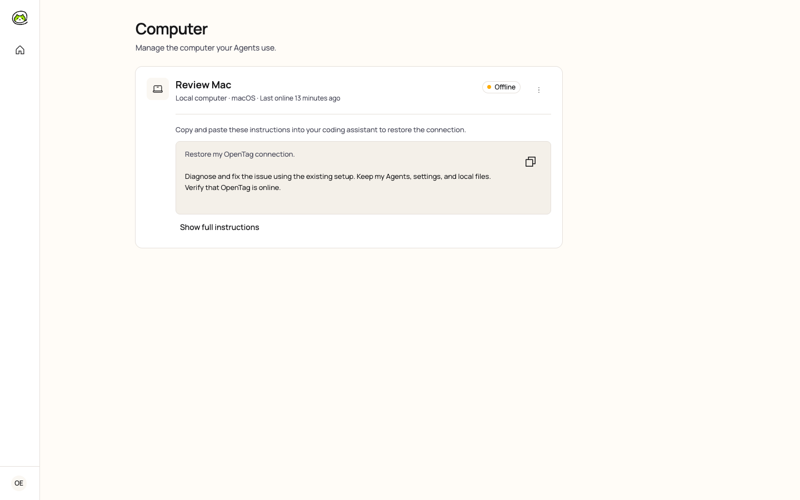
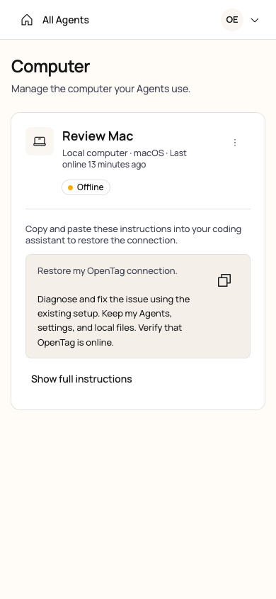
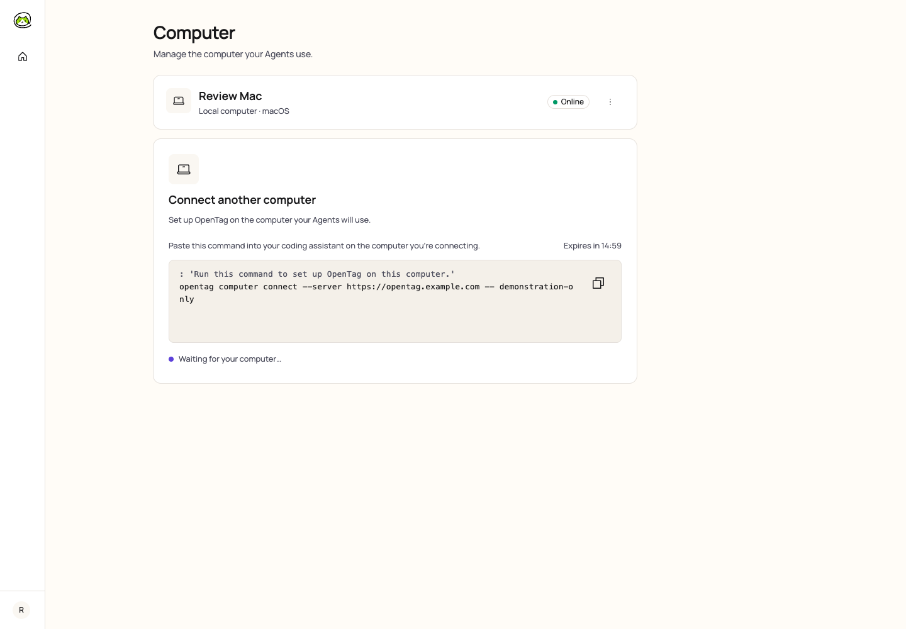
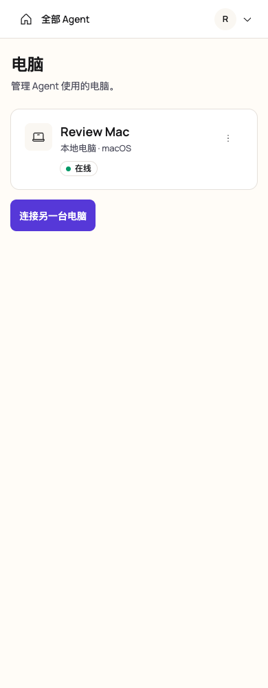

# Computer 管理与恢复界面

[English](./README.md)

同步日期：2026-10-10。截图来自构建后的应用，连接独立的 Server 和 PostgreSQL 数据库。“Review Mac” 是演示电脑；截图不包含连接码或凭据。

所有电脑直接展示在主页面。在线卡片保持紧凑；离线的本地电脑自动展示恢复说明，包括可读摘要、复制完整任务的控件，以及在当前卡片内展开的 **Show full instructions**。连接状态由 Server 更新；复制说明本身不会被视为修复成功。管理菜单只保留 **Remove computer…**，沿用已有的确认和 Agent 绑定保护。

账户已有电脑且清单状态已确认时，页面也提供 **连接另一台电脑**。点击后发起一次新连接，保留已有 Agent 绑定。原有卡片继续显示；只有当前指令对应的新电脑确认在线后，才展示它的卡片。已有电脑在线不会使这次新连接提前完成；新电脑兑换连接码后仍在连接期间，也不会额外发起恢复连接。

## 连接另一台电脑

2026-10-15 使用构建后的应用和本地 API 测试数据验证。中英文入口与等待连接状态在 320、390、768、1440 px 下通过横向溢出和 axe 检查。键盘激活只发起一次新建请求；兑换连接码后，等待对应的新电脑上线。这些检查不代表真实 daemon 已连接。

## 交互验证

- 在 320、390、768 和 1440 px 下检查了收起与展开布局，没有页面级横向溢出或 axe 问题。桌面端 Cloud 与本地在线卡片高度一致；恢复内容按需自然增加卡片高度。
- 完整说明原位展开，不跳转页面、不打开弹窗。复制包含完整诊断任务；剪贴板拒绝访问时，展开并选中任务，支持手动复制。
- 真实 CLI/daemon 链路验证了过期、更新、兑换和自动恢复，保留电脑身份与 Agent 绑定。可选的授权状态请求失败时，仍可通过已有凭据恢复。
- 说明过期后撤下复制控件。过期、兑换或恢复导致当前聚焦的恢复控件消失时，焦点返回所属电脑卡片，不触发滚动。取消移除后，焦点返回操作入口。
- 在 Chromium 中检查了英文、中文移动端布局和受保护的移除流程。九项正式 Playwright 端到端测试通过，覆盖 Agent Setup Lab 流程和浏览器及响应式冒烟测试。

这些检查未调用编程助手的外部 AI 服务。
