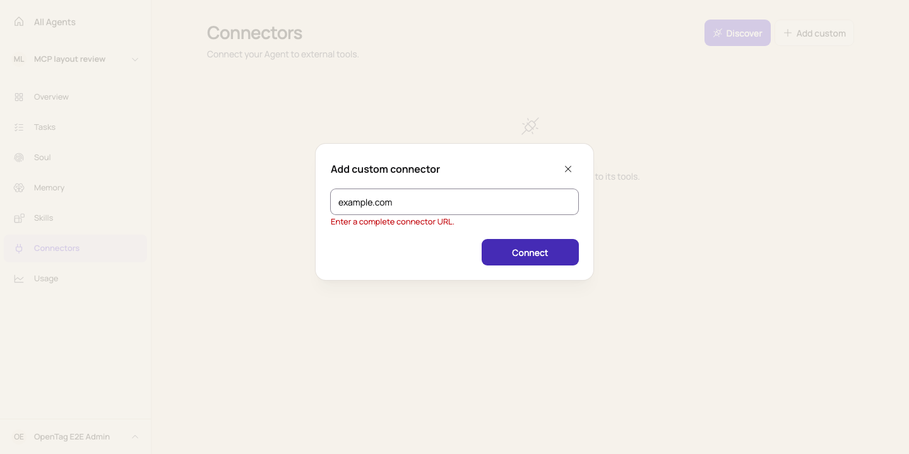
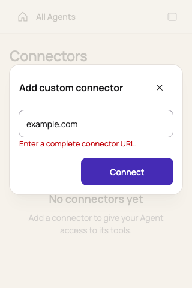

# Independent connector installation in Web

Add custom contains a URL and Connect. The header close button and Escape dismiss the dialog;
the footer has no divider or duplicate Cancel button. Discover and Add custom create an independent
backend definition for each Agent, using the existing management APIs. Account definitions are
not selectable and matching URLs do not cause cross-Agent reuse. Current-Agent installations can
be located, connected, and retried.

Names are automatic. Creation tries the base name, then reads Account names only after a name
conflict and retries with a bounded numeric suffix. Known catalog installations show the localized
service title across cards and dialogs; custom names remain unchanged. No schema or API changes
are introduced. Historical shared mounts and unmounted definitions remain in the backend.

The URL dialog uses a 216px height and does not wait for the Account pool. Its URL label is accessible
to screen readers; localized placeholder copy guides input, and opening focuses the URL field. Key collection,
when an exact preset requires it, expands to 304px on desktop and 320px on narrow screens. OAuth
return handling and temporary-mount cleanup are preserved.

`e2e/tests/mcp-add.spec.ts` covers independent installs, current-Agent duplicate prevention, URL
validation, cancellation/retry, sign-in errors, compact geometry, keyboard focus, Chinese copy,
and accessibility. It uses the built application with fictional MCP responses, without real-provider
authorization. Unit tests additionally exercise key collection and concurrent name collisions.

Current desktop and mobile validation states:

Existing picker, configured-list, and authentication screenshots in this directory record the
previous UI; the configured-connector disclosure has been removed. Updated browser captures are
written to each test's output directory. See [the integration design](../../../../../docs/design/mcp-server-integration.md)
for the retained backend model and management API.
