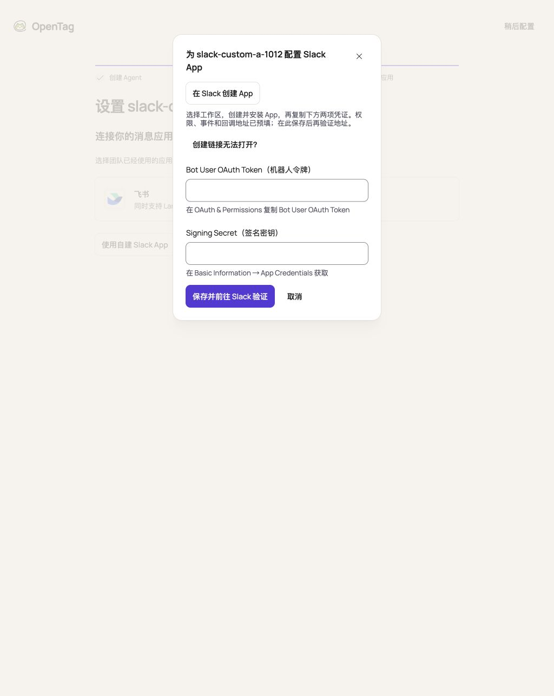

# Custom Slack Apps: design, review, and local acceptance

[简体中文](../zh-CN/design/custom-slack-app.md)

Recorded on 2026-10-13. Product source: `06f548b2d017a76865001c58ed45f53ce525c360`;
implementation base: `75e97ca88bec2c69749347a8674489386c10768a`. Subsequent documentation commits do not change product code.
See [Slack setup](../slack-app-setup.md) for the capability contract and operating instructions.

## Design and user flow

Each Agent uses a different user-created Slack App, installed in the same Team. A current App/Team pair belongs to one
Agent; another Agent cannot claim it. Agent creation succeeds without a Computer or messaging app. Connecting an app
retains the existing Computer requirement. The creation guide and Messaging settings share one concrete configuration
form, available even when first-party OAuth is unavailable.

The user opens the prefilled Slack creation link, chooses the Team, creates and installs the App, then pastes only
**Bot User OAuth Token** and **Signing Secret** and saves once. The manifest includes the existing 18 bot scopes,
7 events, Agent-specific Events URL, writable Messages tab, and existing Interactivity callback. After saving, the user
confirms **Verified → Save Changes** in Slack Event Subscriptions and sends the Bot a DM. No second manifest paste,
manual App/Team/Bot ID entry, or final confirmation page is required. Existing Apps can repair their URLs/events from
collapsed help without replacing their other configuration.

```mermaid
sequenceDiagram
    actor U as User
    participant W as OpenTag Web
    participant S as OpenTag Server
    participant D as Existing database
    participant L as Slack
    participant A as Agent runtime
    U->>W: Create Agent
    W->>S: Create request
    S->>D: Save Agent
    S-->>W: Agent ID
    Note over U,W: Messaging can be configured later; prepare Computer before connecting
    U->>W: Use your own Slack App
    W->>S: GET configuration
    S-->>W: Trusted Events URL and current binding expectation
    W-->>U: Prefilled Slack creation link
    U->>L: Choose Team, create and install App
    L-->>U: Copy Bot Token and Signing Secret
    U->>W: Fill two credentials and save once
    W->>S: POST configuration with expected binding/generation
    S->>L: auth.test, actual scopes, bots.info
    L-->>S: Verified token-derived App/Team/Bot identity
    S->>D: Recheck authority and expectation; encrypt and activate atomically
    S-->>W: Installed; waiting for signed real event
    U->>L: Verify Events URL
    L->>S: Signed URL challenge
    S-->>L: Challenge response
    Note over S,L: Challenge alone does not close App/Team/Bot identity
    U->>L: Save Changes, then DM the Bot
    L->>S: Signed real event
    S->>D: Validate identity; existing scoped receipt/message/Session
    S->>A: Existing delivery path
    A->>L: Reply through existing credential proxy
    W->>S: Read readiness while pending
    S-->>W: Identity and runtime ready
```

## Data, compatibility, and simplicity

There are **no new database tables, columns, persisted fields, or migrations**. Reuse encrypted `slack_installations`,
`im_bindings`, generation fences, existing receipt keys, messages and Sessions. There is no `configuration_method`,
`slack_bot_message_policy`, App registry, new setup state machine, or generic Provider framework. Recovery preference is
derived by comparing existing installation credentials with configured first-party OAuth material.

This includes necessary GET/POST configuration APIs as well as Web changes. The server derives the App identity from
`auth.test` and `bots.info`, checks actual scopes, and rejects cross-App updates before writing. Nonempty credential
updates preserve blank values and require the same App/Team/Bot identity. The commit transaction rechecks Account
authority, Computer, binding ID and generation. Uncertain save results are resolved by reading state, never automatic POST
replay. Credentials are cleared on success, close, and Agent changes and are never returned by the management API.

First-party OAuth start/callback and explicit replacement semantics, signed Events, proxy/runtime, old CLI contracts,
and Feishu remain. Older servers keep OAuth recovery; missing `slackOAuthAvailable` retains the old behavior and only
explicit `false` hides the entry. Both human and other-Bot messages follow Agent `receiveMode`; `all_message` ambient
messages can complete silently. Binding-scoped projection/delivery prevents Team-wide deduplication from dropping events
seen independently by two Apps.

## Code review and cleanup

Review was a separate pass in the same chat over the complete diff and call chains; it was not a second reviewer or an
external review service. Findings were repaired before the final validation. No remaining concrete blocking defect was
identified within that scope.

| Finding | Resolution |
| --- | --- |
| P2: official recovery appeared even when OAuth was unavailable | Gate on explicit `false`; test true, false and omitted availability. |
| P2: URL challenge hid the return-to-Slack link before Save Changes | Keep the link while identity is pending and explain Save Changes before sending a DM. |
| P3: ready dialogs kept polling every two seconds | Poll only an open, pending, nonediting dialog; stop when ready. |
| Duplicate scopes check | Each configuration entry validates scopes once. |
| Repeated installation identity comparison inside the transaction | Remove the extra parameter/branch; retain same-token identity checks and binding/generation compare-and-set. Add concurrent OAuth replacement regression. |

Review cleanup reduced product source by 12 net lines and added 89 net test lines relative to `9d9ab4c4`. It did not add
complexity exceptions or weaken credential, signature, authorization, isolation, or concurrency checks. A live ready
dialog observation at `09e4e538` recorded one configuration GET and zero additional GETs over 11.60 seconds; the last Web
compatibility repair did not change polling code.

## Automated validation and revision boundaries

| Check | Actual target and result |
| --- | --- |
| `pnpm check` / `pnpm build` / `pnpm typecheck` | `06f548b2`: pass; typecheck 12/12, complexity ratchet 127 warnings / 42 improvements with unchanged budgets. |
| `pnpm test` | `09e4e538`: 628 script tests + 9,672 workspace tests pass (12/12 tasks, 10 cached). |
| Final affected Web regression | `06f548b2`: 5 files, 71 tests pass, including omitted availability and old-server recovery. |
| PostgreSQL integration | `06f548b2`: 55 files, 707 tests pass with default `maxWorkers=2`, 175.66 seconds. |
| Runtime coverage | `5fa54a3e`: 28 files, 580 tests pass; statements/branches/functions/lines all 100%. Client runtime source did not change afterward. |

`06f548b2` differs from `09e4e538` only in the Web availability condition and its regression test. The full unit result
belongs to its actual target; the final 71 Web tests are not added to the old total to imply a new full-suite run.

An earlier integration run at `09e4e538` passed 705/707: an unchanged history-cap case timed out at five seconds, followed
by a Feishu recall deadlock. The complete failed file then passed 100/100 unchanged, followed by the final full 707/707
pass. Timeouts, assertions, worker configuration and skip conditions were not relaxed. The initial root cause remains
unproven; parallel load and work surviving the timed-out case are a hypothesis. A first review typecheck also caught a
new test's incorrect method name; it was corrected before completed validation. Failed/interrupted logs are retained in
the task-local evidence directory rather than counted as passes.

## Real Slack acceptance

Tier: **focused-local**, using the logged-in **Local-team** and two explicitly authorized new Apps:
`slack-custom-a-1012` and `slack-custom-b-1012`. App creation, install, configuration, message sending and approval actions
used Computer Use. Both installed the same 18 scopes. Model calls used explicitly selected **Codex `gpt-6.1-sol`**,
authorized by the user because Gemini 3.8 Flash was unavailable. The actual provider turn records confirmed the model and
`on-request` approvals; permanent command permissions were not widened.

Live ingress/reply/restoration/isolation/approval scenarios ran at `5fa54a3e`; the Events copy was updated at `8ce56c39`,
and A's post-restart reply plus the final guide wording were checked at `9d9ab4c4`. The latest recovery UI was checked at
`06f548b2`. Original live results are not represented as a repeat on the later review source.

| Scenario | Observed result |
| --- | --- |
| Create before messaging | A was created without Computer or IM binding, then connected to the isolated Computer. |
| Independent App setup | Both Apps created and installed from the product's prefilled manifest; Events Verified and Save Changes completed. |
| A DM | Request `1791857114.008369`; reply `1791857129.711449`: `APP-A-OK-1013`. |
| B DM | Request `1791857390.070949`; reply `1791857403.961069`: `APP-B-OK-1013`. |
| Cross-App Token rejection | A's Token was rejected for B; B's installation, binding, generation and Session were preserved. |
| Secret-only restoration | B generation 1→2; blank Token preserved; same binding/DM Session; `APP-B-RESTORED-1013` at `1791857507.445349`. |
| Token-only restoration | B generation 2→3 after restart; blank Secret preserved; subsequent signed messages and approval succeeded. |
| Same Team, same private channel | A replied `CHANNEL-A-1013` at `1791857747.145289`; B replied `CHANNEL-B-1013` at `1791857761.937909`; independent Sessions and projections. |
| Other Bots and receive mode | B in `mention_only` retained history without deliveries; A in `all_message` accepted B's ambient message, completed silently, and did not loop. B restored to `all_message`. |
| Native Slack approval | Public read-only `curl --head --max-time 10 https://example.com`, approved through existing Interactivity; B replied `APPROVAL-B-OK-1013` at `1791858176.660779`. |
| Restart persistence | Original credentials survived restart; A replied `APP-A-PERSISTED-1013` at `1791858722.187919`. |

Restoration reused the same valid credential values; it did **not** rotate Slack secrets or revoke a live Token. This
was local acceptance, not deployment. Test Apps, Agents, private channel, database, foreground client and temporary
callback service were retained for inspection. Admin app-approval policy, Marketplace/Enterprise installs, credential
rotation, and individual file/reaction external operations were outside scope. OAuth and Feishu compatibility were
covered by local regression, not new external reauthorization.

Only inspected test Web screenshots are included below. Original Slack screenshots, sanitized event/delivery/model
records, frozen build hashes and complete logs remain in the task-local evidence archive. No credential material or
private environment files are attached.

## UI evidence

The creation screenshot is the original live product guide; the ready-settings screenshot is from `06f548b2`.
Manual product acceptance used desktop layouts. Dedicated mobile-width and screen-reader acceptance was not performed;
older responsive prototype checks do not count as current product validation. Components reuse existing Dialog, Input,
Button and Collapsible primitives; no new theme value or CSS exception was introduced.




