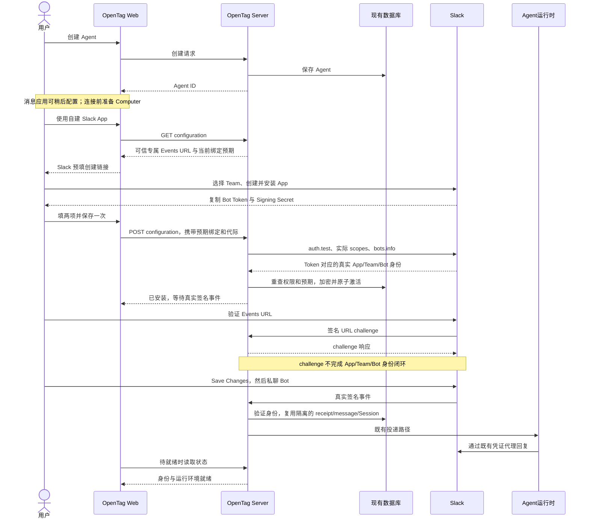

# 自建 Slack App：方案、代码审查与本地验收

[English](../../design/custom-slack-app.md)

记录日期：2026-10-13。产品源码：`06f548b2d017a76865001c58ed45f53ce525c360`；实施基线：
`75e97ca88bec2c69749347a8674489386c10768a`。后续文档提交不改变产品源码。
完整权限合同与操作说明见 [Slack 配置](../slack-app-setup.md)。

## 方案与产品流程

同一 Team 的每个 Agent 使用不同的用户自建 App；一个当前 App/Team 安装仅归一个 Agent，不共享或转让。
Agent 可在没有 Computer 和消息应用时创建；连接消息应用仍沿用已有 Computer 前提。创建引导与消息设置共用
一个具体表单，官方 OAuth 不可用时也能进入。

用户打开预填创建链接、选择 Team、创建并安装 App，仅粘贴 **Bot User OAuth Token** 与 **Signing Secret**，保存一次。
完整 Manifest 预填现有 18 项 scopes、7 项 events、Agent 专属 Events URL、可写 Messages tab 和既有 Interactivity 回调。
保存后在 Slack Event Subscriptions 确认 **Verified → Save Changes**，直接私聊 Bot。不需再次粘贴 Manifest、
填写 App/Team/Bot ID 或点击最终确认。已有 App 通过折叠帮助补齐事件与 URL，保留其他配置。

## 数据、兼容性与简单性

**零新增数据库表、列、持久字段或迁移。** 复用加密的 `slack_installations`、`im_bindings`、generation、既有 receipt、
消息与 Session。没有 `configuration_method`、`slack_bot_message_policy`、App 注册表、新安装状态机或通用 Provider 框架。
恢复入口通过安装凭证与现有官方 OAuth 配置比较派生。

包含必要 GET/POST 配置接口，不能称为仅修改 Web。服务端由 `auth.test` 和 `bots.info` 获取 App 身份，检查真实 scopes，
写入前拒绝跨 App 更新。非空凭证覆盖、空项保留，更新保持原 App/Team/Bot 身份。提交事务重查 Account 权限、Computer、
绑定 ID 与代际。不确定结果只读恢复，不自动重发 POST。成功、关闭或切换 Agent 时清除输入，管理 API 不返回密钥。

保留官方 OAuth start/callback 及显式替换语义、签名 Events、代理/运行时、旧 CLI 合同和飞书。旧 Server 保留 OAuth 恢复；
`slackOAuthAvailable` 缺省时沿用旧行为，仅明确 false 时隐藏入口。真人与其他 Bot 统一使用 Agent.receiveMode，
`all_message` 环境消息可以执行后静默。消息投影/投递按 Binding 隔离，不使用 Team 级去重吞掉另一 App 的事件。

## 代码审查与清理

审查是在当前 chat 与实现分开的完整差异和调用链复查，没有第二审查者或外部审查服务。发现均在最终验证前修复，
所列范围内未发现仍未处理的具体阻塞缺陷。

| 发现 | 处理 |
| --- | --- |
| P2：官方 OAuth 不可用仍显示恢复入口 | 仅明确 false 时隐藏，覆盖 true/false/缺省回归。 |
| P2：URL challenge 后过早隐藏 Slack 设置返回入口 | 身份 pending 时保留链接，提示 Save Changes 后发 DM。 |
| P3：就绪弹窗仍每两秒轮询 | 仅打开、待就绪且未编辑时轮询，就绪即停止。 |
| 重复 scopes 检查 | 每条配置入口保留一次校验。 |
| 事务重复比较安装身份 | 删除多余参数和分支，保留 Token 同身份检查及绑定/代际 CAS；补充 OAuth 并发替换回归。 |

相对 `9d9ab4c4`，清理使产品源码净减少 12 行，测试净增加 89 行；没有增加复杂度例外或削弱凭证、验签、权限、隔离和并发保护。
在 `09e4e538` 对真实就绪弹窗观察 11.60 秒，配置 GET 保持一次，无新增查询；最后 Web 兼容修正未修改轮询逻辑。

## 自动验证与版本边界

| 检查 | 实际目标与结果 |
| --- | --- |
| `pnpm check` / `pnpm build` / `pnpm typecheck` | `06f548b2` 通过；类型 12/12，复杂度 ratchet 127 warnings / 42 improvements，未改预算。 |
| `pnpm test` | `09e4e538`：628 项脚本 + 9,672 项 workspace 测试通过，12/12 任务，10 项缓存。 |
| 最终直接受影响 Web 回归 | `06f548b2`：5 文件、71 项通过，覆盖 availability 缺省和旧 Server 恢复。 |
| PostgreSQL 集成 | `06f548b2`：55 文件、707 项通过，默认 maxWorkers=2，175.66 秒。 |
| Runtime coverage | `5fa54a3e`：28 文件、580 项通过，语句/分支/函数/行均 100%；此后客户端运行时代码不变。 |

`06f548b2` 相对 `09e4e538` 仅修改 Web availability 条件及回归。全量单元结论保留在其真实目标，未将最终 71 项加到旧总数
冒充新版本全量执行。

`09e4e538` 首次完整集成通过 705/707：既有历史消息 cap 用例在 5 秒超时，随后 Feishu recall 死锁。原失败文件单独复跑
100/100 通过，最终完整命令 707/707 通过，未放宽超时、断言、worker 配置或跳过条件。初始根因尚未证实；并发负载及超时
后未取消工作仅为解释假设。更早一次类型检查还发现新增测试方法名错误，完成验证前已修正。失败/中断日志保留在本任务
本地证据目录，不计作通过。

## 真实 Slack 验收

层级 **focused-local**。使用已登录的 **Local-team**，经用户明确授权创建 `slack-custom-a-1012`、`slack-custom-b-1012`
两个 App。创建、安装、填写、发送消息与审批均通过 Computer Use；两 App 使用相同 18 项 scopes。
Gemini 3.8 Flash 不可用，用户批准显式选择 **Codex gpt-6.1-sol**；实际 provider turn 记录核对模型与 on-request 审批，
没有扩大永久命令权限。

收发、恢复、隔离和审批场景在 `5fa54a3e` 执行；`8ce56c39` 更新事件指引；`9d9ab4c4` 核对 A 重启后回复与最终引导文案；
最新恢复 UI 在 `06f548b2` 核对。没有将历史真实测试冒充后续审查源码的再次执行。

| 场景 | 观察结果 |
| --- | --- |
| 先创建 Agent | A 无 Computer/消息绑定时创建，随后连接隔离 Computer。 |
| 独立 App 配置 | 两 App 从产品预填 Manifest 创建并安装；Events Verified、Save Changes 完成。 |
| A 私聊 | 请求 1791857114.008369；回复 1791857129.711449：APP-A-OK-1013。 |
| B 私聊 | 请求 1791857390.070949；回复 1791857403.961069：APP-B-OK-1013。 |
| 跨 App Token 拒绝 | A Token 更新 B 被拒绝，B 原安装、绑定、代际及 Session 保留。 |
| 仅 Secret 恢复 | B 代际 1→2，空 Token 保留，绑定/DM Session 不变；1791857507.445349 回复 APP-B-RESTORED-1013。 |
| 仅 Token 恢复 | 重启后 B 代际 2→3，空 Secret 保留；后续签名消息及审批成功。 |
| 同 Team 同私有频道 | A 在 1791857747.145289 回复 CHANNEL-A-1013；B 在 1791857761.937909 回复 CHANNEL-B-1013；Session 与投影独立。 |
| 其他 Bot 与接收方式 | B mention_only 仅保存历史无投递；A all_message 接受 B 环境消息后静默，无回复循环。最后 B 恢复 all_message。 |
| Slack 原生审批 | 公开只读 curl --head --max-time 10 https://example.com 经既有 Interactivity 批准；1791858176.660779 回复 APPROVAL-B-OK-1013。 |
| 重启持久化 | 原凭证保留；A 在 1791858722.187919 回复 APP-A-PERSISTED-1013。 |

恢复使用相同有效值重新保存，**未轮换 Slack 密钥或撤销真实 Token**。本次为本地验收，没有部署。测试 App、Agent、私有频道、
数据库、前台 client 与临时回调服务保留供检查。管理员 App 审批策略、Marketplace/Enterprise 安装、真实密钥轮换和逐项外部
文件/Reaction 操作不在范围。OAuth/飞书通过本地回归覆盖，没有再次外部授权。

下方仅附已检查的测试 Web 截图。原始 Slack 截图、脱敏事件/投递/模型记录、冻结构建哈希及完整日志保留在本任务本地证据归档；
不附凭证材料或私有环境文件。

## UI 证据

创建截图来自原真实产品引导，就绪设置截图来自 `06f548b2`。手工产品验收使用桌面布局；未单独完成移动宽度和屏幕阅读器验收，
旧响应式原型检查不算当前产品验证。复用既有 Dialog、Input、Button、Collapsible，没有新增主题值或 CSS 例外。

