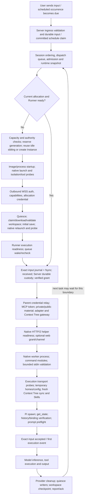

# Cloud startup performance

Supports [Cloud execution](../../../docs/system/cloud/cloud-runner-execution.md),
[Runner toolchain](../../../docs/system/cloud/cloud-runner-toolchain.md), and
[workspace persistence](../../../docs/system/cloud/cloud-workspace-persistence.md).
Component measurements do not establish native Cloud acceptance.

## Endpoints and attribution

For interactive input, the user endpoint starts when the triggering client sends the message.
Server ingress receipt is a second, separately observable endpoint; it excludes IM-provider
transport before ingress. For a schedule, start at the intended `scheduledFor` instant and
separately record the scheduler's committed claim and transport send. Record clock source and
clock offset uncertainty when joining timestamps across machines. Use monotonic time within a
process; never subtract unrelated monotonic clocks.

Startup ends when the provider confirms this exact input or emits its first execution event.
A Server acceptance response, Runner `delivery:received`, ready Instance, or spawned Pi process
does not satisfy that endpoint. Record first model request and first user-visible output
separately. Model inference, output generation and terminal cleanup are not startup savings.
Pi native compaction can precede prompt acceptance and makes a model call; attribute it as
pre-input model work rather than ordinary initialization or new-input inference.



The native launch/probe occurs before WSS authentication, then workspace preparation destroys
that namespace and launches/probes again after restoration. A warm Instance still creates a
new worker and Pi process for each input; it does not retain provider process memory.
Both probe boundaries and checkpoint ordering remain part of the reliability contract.

Source owners:

| Segment | Current implementation | Attribution |
| --- | --- | --- |
| Interactive queue and environment ensure | `packages/server/src/runtime/im-delivery-worker.ts`, `im-delivery-cloud.ts` | Ingress queue, lane/admission, allocation wait and bounded retry/backoff |
| Scheduled claim and preparation | `packages/server/src/services/schedules/scheduler.ts`, `sandboxes/cloud-session-collaboration-owner.ts` | Due-to-scan delay, committed claim, Runner preparation and handoff |
| Allocation and idle reuse | `packages/server/src/services/sandboxes/sandbox-runner-service.ts`, `cloud-run/cloud-run-admin.ts` | Capacity/authority, provider API, reuse seal/transfer and create convergence |
| Runner readiness and restore | `packages/client/src/runner/serve.ts`, `serve-workspace.ts`, `cloud-workspace.ts`, `native-sandbox.ts` | Process/image, native probes, auth, conditional archive transfer and installation |
| Input custody and execution material | `packages/client/src/runner/cloud-turns.ts`, `native-provider-bridge.ts` | Journal/verification, credential relay, certificate/adapter, native helper and optional capability grants |
| Worker preparation | `packages/client/src/runner/worker.ts`, `cloud-turn-worker.ts`, `cloud-context-tree.ts` | Module load and stdin, transport proofs, ephemeral configuration, Context Tree freshness and skills |
| Provider readiness and input | `packages/client/src/providers/pi/agent-runtime.ts`, `rpc-wire.ts` | Spawn, `get_state`, history validation, preflight/compaction and prompt acceptance |

Do not sum overlapping spans. The worker's `worker_preparation` duration is an envelope;
Pi phase diagnostics use their own local sequence and elapsed clock. The parent
`worker_startup` to worker-ready span includes module load, stdin and validation, not model
readiness. Missing phase diagnostics are missing evidence, never zero duration.

## Repeatable local worker comparison

`scripts/e2e/cloud-startup/worker-benchmark.mjs` runs the real built Runner CLI and Cloud worker with pinned Pi against a
loopback-only OpenAI-compatible model fixture. The transport endpoints use a synthetic execution
CA and fixed status responses; no real provider, credential service or native Sandbox is involved.
The model fixture observes a random marker in the actual request to prove the exact input arrived.
It verifies one request per input and the previous input in sequential/restored histories.

Run it in a fresh, owned Linux container with networking disabled and 1 CPU / 1 GiB. It deliberately
refuses to run without `OPENTAG_STARTUP_FIXTURE=1` or on a non-Linux host because it creates the
container's `/workspace`, `/run/opentag-execution/fixture` and `/usr/local/bin/pi`.
Never mount a real HOME, credentials, Session workspace or production configuration.

Prepare an owned fixture directory with:

- `before/dist` and `after/dist`: Client builds of the exact compared revisions, with all chunks.
- Each build's exact runtime dependency closure in `node_modules`, assembled with
  `scripts/runner/runtime-closure.mjs`. Dependencies must be identical for a command-loading comparison.
- `pi/package.json` and `pi/package-lock.json` copied from `scripts/runner/pi/`, installed in
  a separate setup container with frozen `npm ci --omit=dev --ignore-scripts --no-audit --no-fund`.
- `request.json`: a synthetic valid `RunnerCloudTurnWorkerRequest`, with fixed Agent/runtime
  identity, no Context Trees, no MCP/web grants, no external resources and a fixture-only model token.
- `tls/ca.pem` and `tls/key.pem`: an owned synthetic certificate/key with `localhost` and
  `127.0.0.1` SANs. These are fixture keys, never account or platform material.

After building both checkouts, `prepare.mjs` creates that layout and records source/diff and
build-module hashes. Its destination must not exist:

```sh
node scripts/e2e/cloud-startup/prepare.mjs \
  /absolute/built-before-checkout /absolute/built-after-checkout /absolute/owned/fixture
```

Install the locked Pi dependencies in a setup container before the network-disabled benchmark.
For the adapter-inclusive mode below, the benchmark image must also contain OpenSSL; a plain
Node slim image does not. Record the image ID and OpenSSL version after preparing that image.

Pin and record the local image ID, Node version, Pi lock version, architecture, source SHAs,
dirty diff identity, container CPU/memory settings, sample count and concurrent host activity.
Do not substitute an old Docker Runner image for the current source build.

```sh
docker run --rm --network none --cpus=1 --memory=1g \
  --env OPENTAG_STARTUP_FIXTURE=1 \
  --env OPENTAG_STARTUP_STAGE_LOCAL=1 \
  --mount type=bind,source=/absolute/owned/fixture,target=/fixture \
  --mount type=bind,source=/absolute/checkout/scripts/e2e/cloud-startup,target=/harness,readonly \
  <recorded-node-image-id> \
  node /harness/worker-benchmark.mjs /fixture /fixture/results.json 30
```

Before and after alternate first position on each iteration. Every attempt is retained,
including first processes, permanent model rejections, deadline failures and harness timeouts.
p50/p95 use nearest rank, with counts and success/failure/timeout totals. No p99 is reported at
these sample sizes. The fixture's first-model-request timestamp excludes model response time;
the deterministic response is not evidence of real inference speed. `cpu.stat` deltas measure
the container workload including the fixture; concurrent deltas overlap and must not be summed.
`memory.peak` is a combined-run maximum, not a per-version memory comparison.

`OPENTAG_STARTUP_STAGE_LOCAL=1` first copies the fixture, builds and dependency bytes into the
container's Linux filesystem. This avoids timing Docker Desktop's host-file sharing as if it were
image storage. Staging finishes before timing starts, uses no network and is removed at completion.
The peak-memory counter includes this setup; it remains a whole-run bound. Keep mount-based runs
as separate datasets, never pool them with staged runs or discard their failures. Each sample
also records cgroup CPU throttling and memory events. A partial checkpoint every ten iterations
keeps completed samples recoverable after a failed harness process.

Set `OPENTAG_STARTUP_INCLUDE_ADAPTER=1` to measure from the real production execution adapter's
start, including fresh certificate generation, through the real worker and Pi to the exact input
at the model fixture. Each execution uses a new parent material directory, certificate and public
manifest. Two local byte tunnels connect the fixed worker ports to that execution's actual adapter;
the normal CONNECT refusal and execution-CA-pinned TLS challenge both run. The private key remains
outside the worker's execution directory and workspace. The credential relay and native Sandbox
HTTP/2 helper remain unmeasured. This mode runs each sample serially because the relocated worker
ports share one local network namespace; it does not run or claim concurrent physical Sessions.
`adapterReadyMs` is nested inside the total and must not be added to it again.
`workerReadyMs` also uses the harness clock and includes adapter time in this mode; subtract
`workerSpawnMs` per sample to isolate worker process startup. `promptAcceptedWorkerElapsedMs`
uses the worker diagnostic clock and is not an end-to-end timestamp.

`adapter-concurrent.mjs <fixture> <output.json> 30` separately opens two real execution adapters
at once and verifies both CA-trusted HTTPS credential challenges. Use the same container guard,
network isolation and resource limits. It retains rejected attempts and cleanup failures. This
component test does not establish concurrent worker, native namespace or Cloud Session acceptance.

| Local scenario | What it measures | What it does not measure |
| --- | --- | --- |
| Fresh Session | Fresh worker/Pi with new history on an already running container | No-instance Cloud cold start, image pull or allocation |
| Sequential | Fresh worker/Pi with same-Session history on each turn | Retained Pi process memory or previous-turn checkpoint cost |
| Restored files | History after copying away and reinstalling the workspace at the same path | GCS transfer, archive validation, fencing, idle reclaim or native reset |
| Concurrent histories | Two distinct Session history trees under a fixed shared CPU budget | Independent native namespaces or Cloud capacity/isolation acceptance |
| Scheduled input | Real scheduled-origin Session-message worker branch | Due-to-scan delay, claim transaction or preparation/handoff |
| Model rejection/timeout | Same permanent rejection and absolute deadline classification | Live provider availability or delivery retry/ack semantics |

The scheduled fixture targets a visible Channel Session with synthetic outbox context, matching
the fixed-Chat schedule path. The fixture model returns text and never executes an IM command.
An optional final `scheduled-input` argument runs just that scenario plus rejection/timeout
checks, so correcting or investigating that workload does not require repeating unrelated cases.

## Full Cloud acceptance matrix

Retain separate distributions for no existing Instance, ready Instance, idle-reclaimed recovery,
same-Session consecutive tasks, concurrent Sessions, and reusable scheduled triggers. For each,
report attempted/succeeded/failed/timed-out counts and missing trace coverage. Missing starts are
right-censored or failed attempts, not dropped from the denominator. Report successful-duration
quantiles alongside that denominator; do not relabel missing durations as zero or silently blend
failure latency into successful latency.

Cloud runs require a separately authorized environment, exact Server/Runner/image identities,
allocation and Session correlation, real native isolation, restored history, unchanged custody,
and verified resource cleanup. Record CPU/memory settings, billed resource duration and any model
calls used by preflight. Preserve the actual trigger and message effect boundaries; do not replay
production messages or send test messages to real IM users. This local harness does not authorize
Cloud allocation, deployment, production writes or message delivery.
