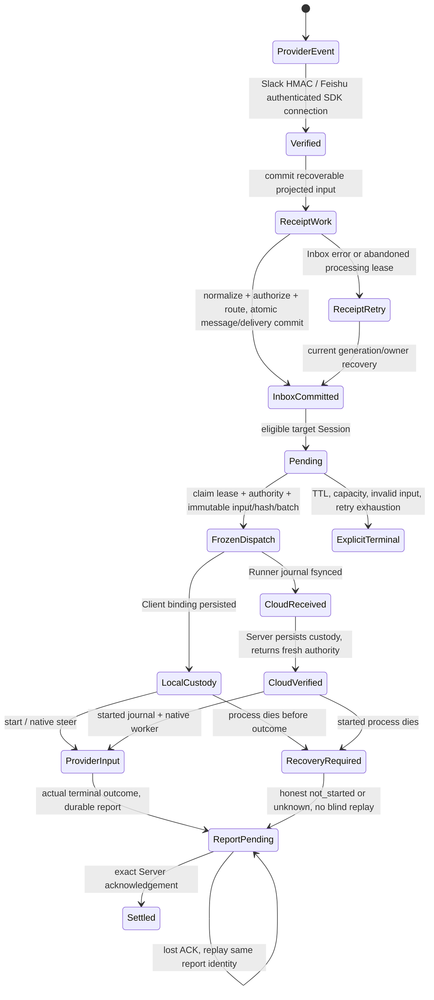

# User input reliability: evidence and acceptance boundaries

Contracts: [message domains](../../docs/system/messaging/message-domains.md),
[Channel and Thread Sessions](../../docs/system/messaging/thread-sessions.md),
[delivery claims](../../docs/system/messaging/im-delivery-claim.md),
[content delivery](../../docs/system/messaging/im-content-delivery.md), and
[Cloud Runner execution](../../docs/system/cloud/cloud-runner-execution.md).

## Baseline and result

Baseline `e4f7cb1d0ca038c13368c7be90f4e7058105a329`, Node 24.20.0, pnpm 10.12.1,
local Docker PostgreSQL. The full no-loss, correctly targeted, ordered-input goal is **not met**.
No production data, historical messages, external IM sends, external model service calls or Cloud deployments
are involved in the checks below. Production delivery/read-write behavior is unchanged. The Web caption
for a grouped message now says "Grouped for execution" and asks the reader to check its execution result;
group membership alone does not establish current activity or successful processing.
The native Runner SIGKILL probe below also runs after integrating main `ca326157`, including its
workspace recovery changes; Server receipt/admission/recovery source is unchanged between these baselines.

A signed Slack request was acknowledged with HTTP 200 after its durable receipt committed. A synthetic
PostgreSQL trigger raised `40001` on the actual Inbox message insert. After removing the trigger, a
newer signed message committed to Inbox. The production `ImDeliverySelector` and transactional
`lockEligibleDelivery` admitted that newer input while the older receipt remained failed and recoverable.
This proves an admission-order defect across receipt and Inbox; no runtime was dispatched by that probe.
The desired no-overtaking assertion failed. The [negative acceptance probe](../im-input-ledger/accepted-receipt-order.patch)
is retained as an opt-in patch because the read/write repair requires a separate human-confirmed design.
From a clean checkout of this baseline, apply that patch, then run:

```sh
pnpm --filter @opentag/server exec vitest run src/__tests__/integration/inbound-receipt-recovery.test.ts -t 'keeps a newer input behind' --maxWorkers=1
```

Expected baseline failure: the older receipt has recoverable input, but `newerEligible` is `true` and the
no-overtaking assertion fails. This is not a quarantined or expected-failure test in CI. Once the approved
repair is implemented, promote the assertion to the normal test suite and remove the patch.

Existing baseline tests passed: 20 focused Server tests, 148 Client journal/custody/Runner tests, and
33 real PostgreSQL receipt/queue-policy tests. A further 49 PostgreSQL custody, concurrent queue, retention
and steered-input recovery cases passed. Their passing result did not detect this cross-stage gap.

## Stages and responsible components



| Stage | Source and responsibility | What the state proves | Recovery owner |
| --- | --- | --- | --- |
| Slack ingress | `api/slack-events.ts`, Slack signature/adapter | HMAC and App/Team/Bot route identity; HTTP 200 after receipt commit | Existing receipt work sweep |
| Feishu ingress | `services/im-bindings/feishu/adapter.ts`, `connection-manager.ts` | Current SDK connection and holder/epoch; normalized saved input before Inbox | Current durable connection holder; no-event-ID inputs retain synchronous path |
| Receipt work | Both receipt stores; `im/inbound-receipt-work-store.ts` | Recoverable bounded input, not Agent input | 60 s lease, attempt-fenced settlement, 2/4/8/16/30 s backoff, seven-day eligibility |
| Inbox/routing | `im/im-message-inbox.ts` | Immutable revision, deduplication and eligible delivery facts committed | Receipt replay is message/delivery-idempotent |
| Queue/claim | `runtime/im-delivery-selector.ts`, worker, work-query and batch helpers | Eligibility and leased attempt, not transmission or Provider receipt | Leased retry with current authority; Agent advisory fence; Cloud Session/Local Agent custody |
| Dispatch | `runtime/runtime-custody-store.ts`, runtime domain / Cloud delivery owner | Frozen exact input and correlation before send | Reconcile that correlation before release; no repackaging on uncertainty |
| Local custody | Client `turn-custody-owner.ts`, `session-binding-store.ts`, `client-runtime.ts` | Accepted input/Turn binding persisted before result send | Reconcile saved binding/report; accepted differs from Provider start |
| Cloud custody | Client `runner/cloud-journal.ts`, `cloud-turns.ts`; Server Cloud delivery owner | received journal persisted, then Server custody verified | received re-verifies; started becomes unknown after process death; reported replays |
| Provider input | Client `agent-turn-runner.ts` and provider adapters; Cloud native worker | Native prompt/steer acceptance at the adapter boundary | Native result plus honest uncertainty; no distributed exactly-once claim |
| Settlement | Local report owner / Cloud report journal + Server custody store | Recorded actual outcome; completed/failed/unknown are distinct | Matching result identity and ACK; late attempts cannot replace terminal results |

Only Feishu and Slack call the production IM Inbox. Runtime Session collaboration and schedules have
separate ingress/authorization semantics; they are not evidence for user IM delivery. Discovery of an
additional human input entry must extend this inventory rather than silently reuse best-effort guarantees.

## Acceptance invariants and unresolved product boundaries

| Invariant | Required assertion / current limit |
| --- | --- |
| Accepted set | Every distinct accepted, route-eligible input revision remains accountable through delivery or visible recovery. HTTP success, receipt processed and claimed are not final delivery. |
| Stable identity | Provider message/revision + target identity survives duplicate callbacks, receipt retry, frozen dispatch, restart, batching and steering. Same content under distinct provider IDs is not automatically the same user action. |
| Correct target | Agent, immutable conversation/thread scope, Session, placement generation and authority match every actual Provider input. Observer and owner copies have explicit separate responsibilities. |
| Order | The declared stream and authoritative sender/provider order must be captured before injection. An accepted, undelivered predecessor blocks a successor; SQL query order alone is insufficient. |
| Uncertainty | Unknown send, started-process death and lost ACK never imply success, no effect, permission to replay, or permission to advance an ordered stream. |
| Recovery | Recoverable failures can resume from durable evidence; permanent/credential failures remain visible with a safe resolution path. A missing reaction is not evidence of receipt or successful recovery. |

Current conflicts remain acceptance failures:

- Capacity evicts older eligible inputs once a Session exceeds 99; same-content adjacent distinct messages
  can become `expired / duplicate_pending`. Their source rows survive, but they do not reach the Agent.
- Direct/continuity and ambient deadlines are seven days and one day. Receipt work also loses recoverable
  payload after its seven-day eligibility window. Durable message history does not itself provide replay.
- Fresh dispatch timeout exhaustion can terminally reject an undispatched input; uncertain correlated
  dispatches can park until expiry. Terminal reason/reaction is not a complete user recovery path.
- Supported Slack subtypes are regular message, message_changed, message_deleted, bot_message and file_share;
  other subtypes and malformed supported events can produce no normalized event while receipt processing ends.
  Bound-bot self events are intentionally excluded. All these filters need explicit classification.
- `mention_only` ignores unaddressed channel input and thread traffic without trusted continuity;
  `all_message` admits ambient thread work and a separate Channel observer. Ended threads are not revived
  by ambient evidence. These are current routing rules, not permission to classify failed eligible input away.
- Inactive Agents, absent Computer binding, ownership/rebind failures and unknown conversation kinds can
  persist message history without creating a delivery. Whether such accepted user input must queue needs
  explicit product confirmation, with no implicit resurrection of removed authority.
- Both pending-input paths now use `(occurred_at, provider_revision_key, im_messages.id)` within a Session.
  The last key is a database UUID, not a sender sequence. Claimed/frozen work is not reordered when an earlier
  provider event arrives late. Receipt-only earlier input is absent from this head query (reproduced above).
- Independent Cloud Sessions can execute concurrently; Local custody is Agent-wide. Cross-provider order,
  cross-Session order after explicit Session end, edit/delete supersession, and late provider input need an
  explicit stream/completeness contract. No passing test below settles those product choices.

## Fault matrix

The middle column identifies existing executable coverage, not a blanket acceptance claim. PG means real
migrated PostgreSQL; Client file tests use real local files. Synthetic native/transport seams remain explicit.

| Fault | Executable evidence / source | Remaining boundary |
| --- | --- | --- |
| Receipt commit then Inbox failure | PG `inbound-receipt-recovery`, `feishu-receipt-recovery` | Live provider acceptance not run |
| Older failed receipt overtaken | New signed HTTP + PG negative acceptance probe | Confirmed defect; read/write proposal pending |
| Receipt lease abandonment / replacement owner | Same PG suites, independent connections; new actual Server SIGKILL test below | Full Provider-input ledger not yet combined |
| Inbox commit, settlement response lost | Same PG suites | End-to-end runtime set/order still needed |
| Duplicate webhook / same event | Receipt store and PG ingress suites | Live provider retry delivery not run |
| Reversed webhook order / late thread root | Inbox/thread and pending-order suites | Already claimed successor cannot be reordered; global sending order unresolved |
| DB commit uncertainty / transaction rollback | Existing idempotent receipt replay; injected `40001` rollback | Actual COMMIT response-drop injection remains unverified |
| Offline / reconnect / 429 / 5xx | Worker retry and provider policy tests | Full accepted-to-Provider ledger not yet combined |
| Retry backoff / exhaust / parked dispatch | Worker/deadline + PG Cloud parking tests | Current terminal policies conflict with no-loss recovery goal |
| Capacity / rapid burst / same-content input | PG queue-policy/pending-queue; Cloud overflow unit tests | Current accepted-set completeness fails by policy |
| Claim expiry / two workers / locked older row | Selector and PG query/pending suites | Extend receipt fence races after human-approved design |
| Local ACK send failure / accepted process death | Client custody, runtime-durability, report recovery tests | Unknown/not_started must not count as delivered |
| Cloud received then real process SIGKILL | New `cloud-turns-process.test.ts` | Re-announces same receipt; zero worker calls until fresh verification |
| Cloud started then real process SIGKILL | Same new process test | Replays same unknown report, zero new worker calls; real Pi/model not used |
| Initial batch reports definitely not_started | Signed-ingress/PG/native-Pi opt-in probe below | Real OS Pi-spawn ENOENT leaves 64 originals undelivered; normal scans and Janitor do not requeue them |
| Native Pi consumed, then Runner SIGKILL | New signed-ingress/native-Pi negative probe below | Local watchdog stops old Pi; Server's documented unknown-Root recovery still replays consumed inputs |
| Cloud reported then SIGKILL / ACK absent | Same new process test | Replays exact report, zero new worker calls; Server ACK path covered separately |
| Changed content or allocation under same identity | Journal/Cloud Runner/custody tests | Live allocation lifecycle acceptance remains separate |
| Cold start / allocation timeout / restart | PG cloud-dispatch-custody and allocation suites | Real Cloud cold start not run; adjacent RSI owns performance |
| Run-time append / duplicate steer / steer result lost | Client cloud-turns + PG custody/recovery; signed-ingress/native-Pi ledger below | Controlled full ledger passes; automatic timeout/reconnect replay and live transport remain unverified |
| Lost Cloud verification / report ACK | Signed-ingress/native-Pi ledger below, actual custody and Runner journal | Explicit reconciliation and exact-frame replay; control transport is IPC, not WebSocket |
| Native Pi burst, success and permanent model error | Manual `pi-input-burst.mjs`: real Pi 0.84.2, four 65-input ledgers | Provider-only evidence; Server routing, native Sandbox and recovered re-dispatch are outside this harness |
| Native send succeeds, response lost | Local steer uncertainty + Cloud steer journal tests | At-least-once transport is distinct from deduplicated Agent processing |
| Root fails after native steer consumption | PG recovery suites; new signed-ingress/native-Pi negative probe below | Confirmed duplicate injection after automatic requeue; separate human-confirmed recovery design required |
| Credential unreadable / permission revoked | PG receipt recovery and Cloud reauthorization tests | Current permanent dispositions and best-effort reaction lack complete user resolution |
| Poison/invalid input, TTL/retention cleanup | Content validation, Janitor, PG retention tests | Must agree on hold/resume/cancel policy; do not automatically skip predecessor |

## Ledger oracle and process tests

[`scripts/verify-im-input-ledger.mjs`](../../scripts/verify-im-input-ledger.mjs) checks an exported synthetic/live JSON ledger.
Each accepted input names `inputId`, `agentId`, `sessionId`, `streamId`, `contentHash`, and integer `order`.
The capture must declare `environment` and `orderingBasis`, including how the authoritative source order
was mapped to integers. It must collect the complete accepted set, including failures and late callbacks.
The oracle cannot establish authenticity or completeness of its own input evidence.

`received` is an ordered list of observed **Provider inputs**, with the same identity/target/content and
`boundary: "provider_input"`. Earlier Server ACK, claim and journal observations are rejected as final receipt.
The oracle rejects missing, unknown, mistargeted, changed, duplicated and overtaking input. `unresolved`
entries keep uncertain outcomes failing. One stream is not automatically split when its Session changes;
independent streams must be explicitly named. Never compare transport retry frames as repeated Agent processing.
An observed input does not prove the Agent completed its task or avoided every external side effect.

```sh
node --test scripts/__tests__/im-input-ledger.test.mjs
node scripts/verify-im-input-ledger.mjs /absolute/path/to/captured-ledger.json
pnpm --filter @opentag/client exec vitest run src/__tests__/cloud-turns-process.test.ts
```

The process test starts a separate Node process running the production CloudTurnRunner and fsynced CloudJournal,
waits for an exact boundary, kills it with SIGKILL, waits for process exit, then recovers from the same directory.
It checks received/started/reported identity and replay behavior; the synthetic worker seam performs no model,
provider, credential, cloud or network operation. It does not test power loss, filesystem loss, native Sandbox
death, or replacement of the physical Instance that held the journal.

`integration/inbound-process-recovery.test.ts` starts a separate Fastify process with the production signed
Slack route, receipt store, adapter and Inbox against migrated PostgreSQL. A real insert trigger rejects
Inbox after HTTP 200; the test kills the Server with SIGKILL while the failure trigger is still installed,
then removes the trigger, starts a fresh process and waits for its normal
five-second receipt sweep. It requires one recovered message and delivery, stable receipt receive time and
identity, and no duplicate on webhook redelivery. All HTTP traffic is loopback and all input/credentials are
synthetic. This verifies Server-process replacement with the same database; it does not dispatch a runtime.

The ledger's ten negative/positive checks run through the existing root script-test discovery, including
real CLI invocation and exit status. The repository verification command lives in `scripts/` alongside the
existing repository tools. Package-only Vitest coverage does not collect root scripts; Node's own coverage
measures the verifier without changing the repository's coverage scopes or thresholds:

```sh
node --experimental-test-coverage --test-coverage-include='scripts/verify-im-input-ledger.mjs' --test-coverage-lines=80 --test-coverage-branches=80 --test-coverage-functions=80 --test scripts/__tests__/im-input-ledger.test.mjs
```

The focused run measures 100% lines, branches and functions. The Cloud
process matrix and PostgreSQL Server-process test use the owning packages' normal Vitest discovery. The new
tests do not change Agent Runtime coverage configuration or its covered implementation/test set.

## Native Pi input-consumption ledger

`packages/client/src/__tests__/manual/pi-input-burst.mjs` runs the actual locked Pi executable through
`PiAgentRuntimeFactory` and `PiRpcProcess`. It uses fresh workspace/config/session directories, synthetic
credentials and a loopback OpenAI-compatible endpoint. The endpoint holds the first response until all
64 concurrent steer calls are acknowledged. The observer records actual native `message_start` events
with role `user`, rather than treating the adapter's `input_accepted` event as consumption.

```sh
node packages/client/src/__tests__/manual/pi-input-burst.mjs /absolute/path/to/evidence-directory
```

Build `@opentag/client` and its workspace dependencies first if its public package export is absent.
The optional output directory receives complete synthetic JSON ledgers and summaries; without it the
script prints summaries only. It deletes its private temporary directories and closes its native process
and loopback endpoint after the run. No external model/IM request is made.

| Pi resource mode | Model behavior after the held first response | Native input / sender set | Whole Run result |
| --- | --- | --- | --- |
| Resources disabled | Successful deterministic SSE | 65/65, ordered, no duplicates | completed |
| Native resources enabled | Successful deterministic SSE | 65/65, ordered, no duplicates | completed |
| Resources disabled | Every later model request returns 401 | 65/65, ordered, no duplicates | failed |
| Native resources enabled | Every later model request returns 401 | 65/65, ordered, no duplicates | failed |

All four cases observed 64 successful steer acknowledgements, 65 native user events and 65 model requests.
The failed cases show why a failed Root report does not reveal which steered inputs the Provider already
consumed. They do not establish that automatically replaying those inputs is safe or that the Agent processed
them successfully. The native Session identity is retained in the summary for traceability.

This harness verifies one Provider lane with an explicit synthetic sender ordinal. Its Agent/OpenTag Session
labels identify the harness lane; they do not independently verify Server routing. It exercises neither
the native Cloud Sandbox nor the Server receipt/claim/report path. The controlled integration below connects
those Server stages to native input observations; real Feishu/Slack/Cloud acceptance remains required.

## Signed-ingress to native Pi ledger

`integration/im-native-input-ledger.test.ts` connects signed loopback Slack HTTP, the real receipt store,
normalizer and Inbox, migrated PostgreSQL, `ImDeliveryWorker` claim/batching, `CloudDeliveryOwner` custody,
and a separate process running `CloudTurnRunner` with its fsynced journal. Its worker seam parses the real
worker request and uses production input projection, `PiAgentRuntimeFactory`, `PiRpcProcess` and the locked
Pi executable. The observer requires each native user event's complete text to equal the projected input
before mapping its synthetic source markers back to the ledger. Server dispatch payloads and input hashes
must match their frozen database values.

Two Agents, with distinct accounts, Computers, Slack apps, DM channels and Sessions, each receive 65 unique
inputs. The 130 originals arrive in reverse provider-timestamp order, with eight duplicate callbacks
(138 signed HTTP requests total). All receipts normalize before dispatch. The ledger requires every original
input exactly once, in its declared stream order, with its original Agent and Session. Each Session stays
below the current 99-input capacity limit; this does not validate the conflicting overflow policy.

The test deliberately loses three kinds of confirmation:

- Agent A's first Server verification is dropped. Durable Server custody alone starts no native input;
  explicit Runner reconciliation resends the receipt, and fresh verification permits execution.
- Agent B's first steer result is dropped. The harness immediately retransmits the identical stored steer
  frame; the real journal returns its recorded result without another native injection. This verifies exact
  replay, not the production timeout/backoff scheduler.
- Both first report acknowledgements are dropped. Explicit reconciliation replays the identical reports;
  the Server replies `recorded`, then `already_recorded`, and the matching acknowledgements clear the journals.

```sh
pnpm --filter @opentag/server exec vitest run src/__tests__/integration/im-native-input-ledger.test.ts --maxWorkers=1
```

Set `OPENTAG_INPUT_LEDGER_OUTPUT` to an absolute file path to save the complete synthetic ledger, verifier
verdict and transmission trace. The trace retains source revision/message/delivery IDs, target generation,
batch membership, dispatch hashes, native input hashes and observed drops/ACK statuses; it excludes model
grants and credentials. Without the variable, temporary evidence is removed after assertions.

The local run passes with 130 accepted and 130 observed inputs, correct targets/order and no duplicates.
Each native input event can contain a batch of original messages. Allocation readiness and the Hub connection
are prepared fixtures; Server/Runner control frames travel over IPC instead of WebSocket. Credential bridging,
native Sandbox transport and the worker-launch boundary are replaced by the native-Pi fixture. Model responses
are deterministic loopback SSE, and no actual Cloud allocation or Slack API is used. This case does not exercise
receipt normalization failure, a late predecessor after dispatch, process death during native execution, model
errors, retention/capacity overflow, attachment input or thread/rebind lifecycle. The confirmed receipt/Inbox
ordering defect and the other product-boundary conflicts above remain unresolved.

### Negative acceptance probe: failed Root replays consumed steers

The [failed-Root probe](../im-input-ledger/failed-root-steer-replay.patch) changes only this controlled
test and its native fixture. The first held model response succeeds; every later response returns 401.
It uses the production `completionForResult` mapping so the Runner reports the actual failed outcome.
Before retry, all 130 originals have already appeared in native Pi user events, but the two failed Root
reports cause 66 steered messages to return to `pending`. Two normal `ImDeliveryWorker.runOnce()` scans
then produce 64 additional native input observations, 32 per Agent. The saved ledger contains 194
observations of 130 distinct originals and the oracle reports 64 `DUPLICATE_PROVIDER_INPUT` findings.
The oracle's `received` total counts distinct identities, so it remains 130 while the duplicate findings fail.

Apply the patch to this test baseline, then run:

```sh
pnpm --filter @opentag/server exec vitest run src/__tests__/integration/im-native-input-ledger.test.ts -t 'does not replay already consumed steered inputs' --maxWorkers=1
```

The no-duplicate acceptance assertion is expected to fail on current production behavior. This is an
opt-in reproduction, not a quarantined test or an expected-failure CI assertion. Remove the patch after
the investigation; after an approved repair, promote the assertion into normal regression coverage.

`writeTerminalReport` in `runtime/runtime-custody-store.ts` invokes `requeueSteeredDeliveries` for every
non-completed Root report. That recovery clears the child's dispatch/turn correlation and permits a fresh
input attempt. This follows the current documented recovery contract in
[IM delivery claim queries](../../docs/system/messaging/im-delivery-claim.md#runtime-budget-and-accepted-recovery) and
[IM Channel and Thread Sessions](../../docs/system/messaging/thread-sessions.md#lazy-thread-continuity).
The probe exposes a conflict between that replay policy and the requested ordered-input/no-duplicate
acceptance contract; it is not evidence of a regression against the documented replay policy.
A failed Root report does not establish that a child was unreceived or had no effect.
This test proves repeated native input under the stated fixture seams; it does not prove repeated external
side effects, successful processing, or real Cloud behavior. The production repair needs a separate concrete,
human-confirmed read/write and recovery contract. The receipt admission fence alone cannot resolve it.

### Negative acceptance probe: native input before Runner SIGKILL

The [native SIGKILL probe](../im-input-ledger/native-sigkill-steer-replay.patch) exercises the same two-Agent
signed-ingress ledger with real Pi, fsynced Runner journals and migrated PostgreSQL. It holds the third
model response after each Pi has consumed its three batches (32, 32, 1 originals), so all 130 originals
have native input observations while both Root journals are `started` and neither Root has reported.
It observes the actual watchdog/Pi process-group PIDs, sends SIGKILL to each Runner, waits for process exit,
and verifies both observed groups stop before fixture cleanup. The local observations took 526 and 547 ms;
the test permits five seconds and does not infer termination merely from the Runner's exit.

Replacement Runner processes reopen the same journals and reconcile. They execute no native worker and
replay identical `unknown / may_have_occurred / turn_state_unknown` reports with the original Root/Turn,
Agent and Session identities. Lost report ACKs exercise the matching replay and clear the journals.
The Server follows its documented policy and requeues 66 steers. Two ordinary worker scans then produce
64 additional native observations, giving 194 observations of 130 distinct originals. The no-duplicate
assertion fails with 64 duplicate findings. The replacement Runner does not itself replay the old execution;
the fresh input attempts arise from Server recovery after terminal settlement.

Apply this patch on a clean test baseline, with the other optional probes reversed, then run:

```sh
pnpm --filter @opentag/server exec vitest run src/__tests__/integration/im-native-input-ledger.test.ts -t 'does not replay native-consumed inputs after Runner SIGKILL' --maxWorkers=1
```

This is another opt-in failing acceptance reproduction of the current recovery-contract conflict,
not a normal passing CI case or an expected-failure test. The saved patch was applied, run and reversed;
its active TypeScript test also passes the Server typecheck. It uses production `PiRpcProcess` process
ownership, but the Pi worker runs directly under the local fixture. Actual Cloud Sandbox transport,
guest-process termination, physical Instance replacement, tools that escape a process group and external
side effects are outside this test. Local PID observations are not a durable Server stop proof and cannot
authorize recovery of an unknown physical Cloud execution.

Full real Feishu, Slack and Cloud acceptance remains incomplete. Local passing tests cannot authorize merge,
deployment, historical replay, live-user messages or resource expansion.

### Negative acceptance probe: initial batch never starts

The [not-started initial-batch probe](../im-input-ledger/not-started-initial-batch.patch) runs the production
`runCloudTurnWorker` for the first execution in each Runner fixture. Its real `PiAgentRuntimeFactory`
and `PiRpcProcess` attempt to spawn a deliberately absent executable in the private fixture directory.
Both operating-system attempts report `ENOENT`; each recorded RPC command list contains only `get_state`,
no `prompt`, and zero native user events. The production worker returns
`failed / provider_start_failed / not_started`; the Runner parses and journals that result, and the Server
records the authentic terminal report. No completion is fabricated. The local mount, prepared manifest,
skipped proxy-readiness probe and unavailable Context Tree result remain explicit seams. This is not a
physical Cloud cold start or proof that every startup error is classified `not_started`. A thrown
`openExecution` error has a different uncertainty mapping and is not the injected fault.

Both first batches contain 32 originals: the two Roots and their 62 `batch_initial` children never enter
Pi. The Roots retain their failed reports while their dispatch payloads are cleared. The children remain
`steered / batch_initial`. Subsequent healthy Roots and steers consume the remaining 66 originals at
real native Pi. Two additional normal worker scans and `runImDeliverySteerRecovery` leave zero pending
deliveries and the first 64 still absent. The final oracle reports 130 accepted, 66 received, 64
`MISSING_INPUT` and 66 `OUT_OF_ORDER` findings, without duplicates.

Authenticated `TaskService.list` reads return `completed` for both synthetic DM tasks after the healthy
suffix. A bounded detail read of all 65 turns in each task still contains its one old `not_started`
report. Task status describes the latest execution; it does not certify completion of the accepted input
set. The grouped-message caption/tooltip clarification above changes neither that status contract nor
recovery behavior. The 122 existing task-page/conversation/status tests and Web typecheck pass after
catalog generation; the task-page assertions explicitly check the revised caption and tooltip.

Apply this patch alone on a clean test baseline, then run:

```sh
pnpm --filter @opentag/server exec vitest run src/__tests__/integration/im-native-input-ledger.test.ts -t 'recovers every original after a definitely not_started initial batch' --maxWorkers=1
```

The saved patch was applied, executed and reversed. Its pre-Pi, terminal-report, retained-batch,
post-recovery and task-projection assertions pass before the desired complete-input assertion fails;
the active test passes Server typecheck and Biome. This is an opt-in failing acceptance reproduction,
not an expected-failure CI case. The healthy suffix still uses actual locked Pi with deterministic
loopback responses; IPC, native Sandbox launch and credential bridge seams remain.

`writeTerminalReport` clears the Root dispatch payload, while `readSteeredCandidates` in
`runtime/im-delivery-recovery.ts` excludes `batch_initial` children from ordinary steer recovery.
This differs from the already-consumed steer replay counterexamples. Recovery must account for the
entire initial batch and preserve terminal attempt/ACK identity. A definite pre-input result can support
a safe retry candidate only for the inputs it actually covers, with fresh authorization and disposition
checks; it does not negate an independent child's positive or uncertain steer receipt. No blind row reset,
automatic replay or production read/write repair is implemented by this evidence work.

### Pre-input evidence and conservative report classification

The real ENOENT case above establishes one production source of `not_started`; the label is not a
general promise about startup errors. `providerProcessFailureCode("spawn")` maps to
`provider_start_failed`, which the Pi adapter and worker preserve through `completionForError`.
An ordinary `openExecution` exception instead becomes `unknown / may_have_occurred`, and a worker
preparation exception escaping `runCloudTurnWorker` is emitted as a generic worker error by `worker.ts`.
Do not infer a known-unstarted batch from its error text or the absence of a native observation alone.

Two focused existing worker tests also establish zero Pi factory invocation when execution timeout or
caller cancellation happens during Context Tree preparation. Temporary completion capture, subsequently
removed, observes `failed / turn_timeout / may_have_occurred` and
`cancelled / client_shutdown / may_have_occurred`. These are conservative classifications despite the
known pre-Pi control point. They are not evidence of successful delivery, nor grounds for automatic
replay under the current recovery contract. No report-classification behavior is changed here.

## Late predecessor and sender-order completeness

The [late-predecessor probe](../im-input-ledger/late-predecessor-order.patch) supplies sender ordinals
1..65 to each of the two synthetic Slack streams, observes original 1..32 at native Pi, and only then
supplies ordinal 0 with an earlier provider timestamp. All receipts finish before further dispatch.
Every original reaches the correct target once: 132 accepted and 132 native observations. Each stream
is observed as `1..32, 0, 33..65`; the strict source-order oracle fails with 64 `OUT_OF_ORDER` findings.
It therefore separates set/target completeness from ordering. Apply this patch alone on a clean test
baseline, then run:

```sh
pnpm --filter @opentag/server exec vitest run src/__tests__/integration/im-native-input-ledger.test.ts -t 'keeps an unseen earlier sender input' --maxWorkers=1
```

The saved patch was applied, executed and reversed; its active test passes Server typecheck and Biome.
It retains the controlled native-Pi harness seams above. This reproduces an unmet sender-completeness
contract, not a regression against a documented universal in-order delivery promise. The proposed
receipt fence only sees already accepted receipts and cannot undo earlier native injection.

[Slack's Events API](https://docs.slack.dev/apis/events-api/#delayed-events-retry) documents best-effort,
potentially delayed delivery and optional delayed retries. A message's
[`ts` is unique per channel](https://docs.slack.dev/reference/events/message/); that does not itself
establish a sender-completeness watermark. The
[Feishu event overview](https://open.feishu.cn/document/ukTMukTMukTM/uUTNz4SN1MjL1UzM) describes ordered
delivery for some event types and defers the guarantee to each event's page. The reviewed
[receive-message page](https://open.feishu.cn/document/server-docs/im-v1/message/events/receive) specifically
requires message-ID-based deduplication; it did not establish the required message-specific completeness
guarantee. Both Feishu pages were read as rendered official pages when text extraction was unavailable.

Inference: sorting known timestamps or adding a debounce window is insufficient proof that earlier
sender actions have all arrived. Strict sender order needs a verified sequence/completeness contract;
alternatively, handling a detected late predecessor through visible recovery is an explicit exception
requiring a product decision. Neither arrival order nor a late-input exception has been adopted by this
verification work. The sender-order authority/late-input decision remains separate from stream scope,
retention and the human confirmation required for any concrete read/write implementation.
