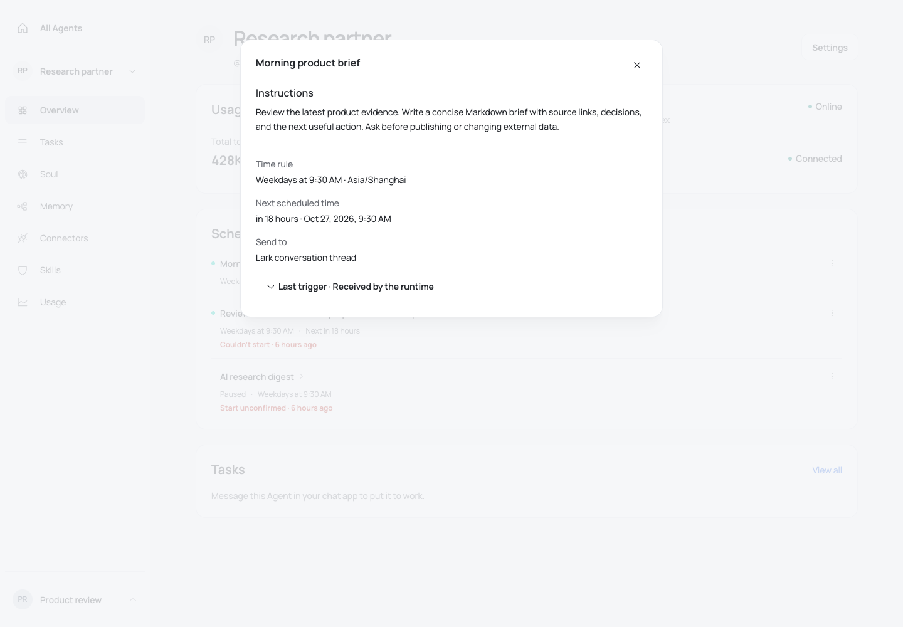
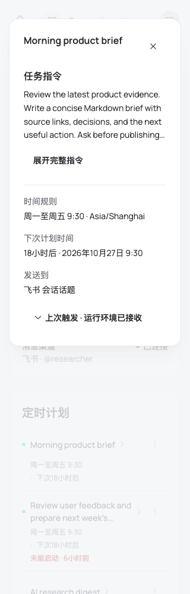
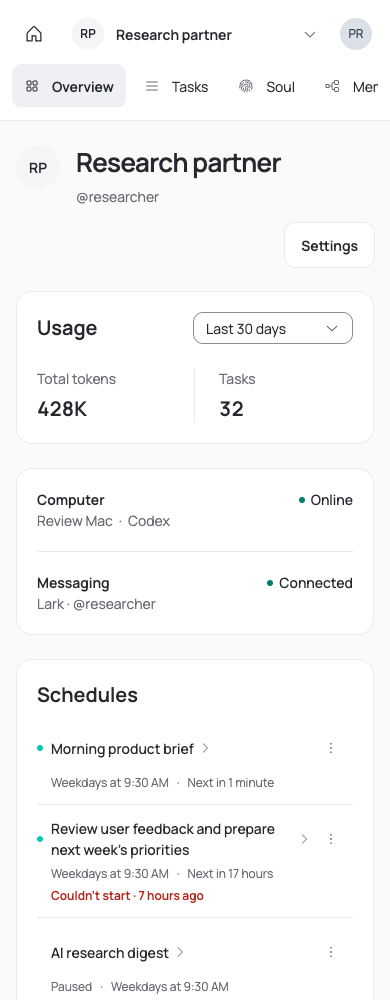
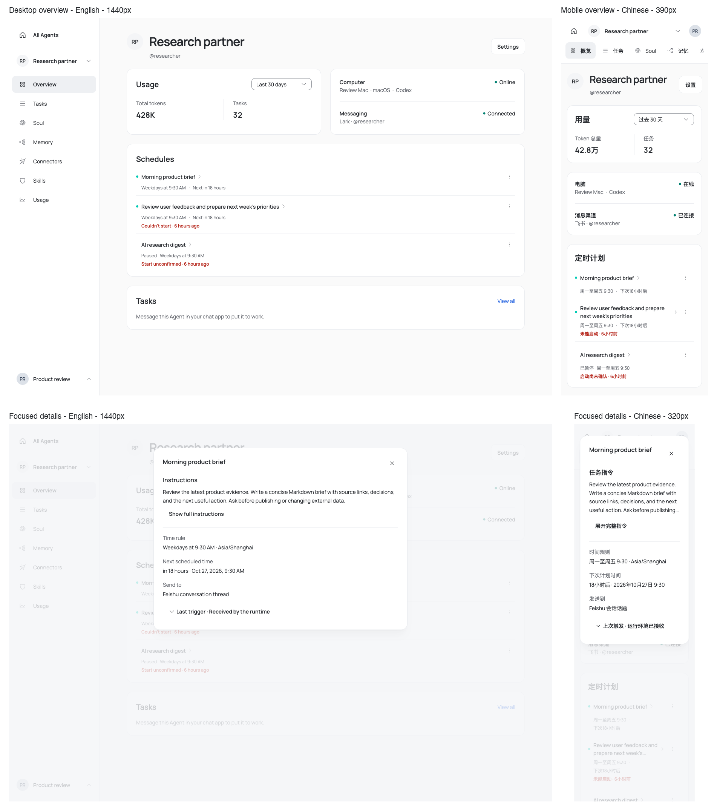

# Schedule experience acceptance and historical Memory review

## Current Schedule journey

The Overview card uses compact divided rows. A name opens private details; the row emphasizes the
friendly time rule and relative next occurrence. Enabled state has a labelled status dot; other dots are decorative so explicit state text is read once. Paused or
exhausted state stays explicit. Normal runtime receipt occupies no extra line. Exceptional/unconfirmed
triggers show a short relative warning that opens details, without claiming task failure or completion.
Relative times refresh locally each minute. When an enabled observed occurrence becomes due, summaries
revalidate once for that schedule and timestamp; an unchanged past occurrence does not loop. No private
prompt is read by the timer. Past observations read Was due, not a future time. Exact timezone-aware timestamps remain in titles; repeated timezone/year/seconds are
removed from the scan path. Complex cron stays literal; the Server remains the schedule calculator.

Details prioritize instructions, friendly rule with timezone, next occurrence and provider/conversation
context. Expansion is offered only for actual rendered overflow, including after resize. Long instructions expand explicitly. Trigger diagnostics and technical identifiers are collapsed
by default; recorded outcome, reason code and exact times remain inspectable. The API supplies no readable
conversation name, so the UI does not invent one. Accepted still means runtime receipt, never completion.

Pause/resume and delete remain in the row menu. Revision checks, summary paging, Agent remount boundary,
deep links and private prompt lazy loading are retained. Deletion confirms impact, prevents overlapping
writes, keeps refused errors, refreshes the observed target after conflict and requires another explicit
confirmation. Missing targets close; failed refresh blocks deletion until explicit read retry recovers.

## Current verification

- `pnpm --filter @opentag/web test src/features/agents/agent-schedules-section.test.tsx src/__tests__/i18n-catalog.test.ts src/im/brand-naming-guard.test.ts src/ui/kumo-contract.test.ts`: 62 tests pass.
  This covers the due tick following the Server's next time, one refresh per unchanged observation,
  failed refresh with explicit recovery, paused schedules, lazy private reads, localized provider names,
  actual paragraph overflow and resize, and the existing catalog and UI contracts.
- Expanded affected Web regression: `pnpm --filter @opentag/web test src/features/agents src/__tests__ src/ui src/im` passes 65 files / 855 tests.
- `pnpm exec turbo run typecheck --filter=@opentag/web --concurrency=2`, `pnpm --filter @opentag/web build`,
  and `pnpm check` pass. The scope covers Schedule composition, catalogs, provider naming and shared UI;
  unrelated package unit/integration suites and Runtime coverage are left to CI because this change alters
  no Server, database, shared contract or Runtime behavior.
- `review-feedback-validation.json`: eight en/zh × 320/390/768/1440 list layouts, sixteen default/long
  instruction checks and eight due-time flows pass. The default desktop prompt fits and has no expansion
  button; the 320px prompt clips and can expand. Server advancement changes the displayed next time with
  one summary request and no detail read. An unchanged past occurrence causes no further request.
- Four fresh scoped axe WCAG A/AA/2.1 AA scans report no automatic violations. These cover English default
  desktop details and long narrow details, and Chinese default/long narrow details; they are not full
  accessibility or deployed acceptance.
- Six `review-{list,detail,due-refresh}-*.png` captures show the revised UI. The observations below describe
  the earlier composition; their screenshot text is superseded where provider labels, expansion controls,
  or due labels changed. The former focused-test count was misstated as 53; that three-file run comprised
  38 Schedule + 3 catalog + 17 design-system tests, or 58 total.

## Earlier composition evidence

- `schedule-information.json`:40 en/zh ×320/390/768/1440 state layouts, no page/frame/section overflow,
  no private detail reads before opening; eight default detail layouts and keyboard diagnostic disclosures.
- `schedule-long-instructions.json`:eight long-title/instruction expand/collapse flows; expanded content
  stays horizontally bounded and its bottom is reachable with 24px padding. Two current list axe scans
  plus two detail scans found no automatic WCAG A/AA/2.1 AA violations, not full accessibility acceptance.
- `schedule-conflict-current.json`:eight en/zh four-width 409→summary refresh→explicit retry flows submit
  revisions[2,3], perform no private prompt read and preserve the existing mutation safety contract.
- The first new 320px detail capture exposed an unbreakable diagnostic trigger widening the grid. The
  final bounded grid/wrapping trigger fixes it; the complete current runs above were captured afterward.
- `schedule-due-labels.json`:fresh final-build normal captures plus due-now/overdue labels at narrow
  widths fit without private detail reads. They do not imply an occurrence completed.
- Raw same-origin favicon observations are retained separately from business API assertions. A driver
  selector also matched the Chinese actions label; it was narrowed to the exact title. Local preview
  restarts after turn interruptions are harness recovery, not product regressions.

All captures use the production App/router/shell/components/CSS/translations with synthetic APIs. The
Schedule fixture fixes time at Monday 2026-10-26 16:00 Shanghai: last weekday trigger Monday 09:30, next
Tuesday 09:30. This corrects the older Saturday-next/weekday-rule mismatch. There is no live repository,
Schedule, delivery or runtime side effect. Stored English example names do not change with locale.

## Current rendered evidence

The gallery below predates the feedback fixes and is retained as earlier composition evidence.

- `schedules-after-{en,zh}-{390,1440}-normal.png`:current production-shell overview.
- `schedules-detail-en-1440.png`, `schedules-detail-zh-320.png`:default focused details.
- `schedules-diagnostics-zh-320.png`:expanded diagnostic content with reachable padded bottom.
- `schedules-after-en-1440-empty.png`:current empty state.
- `schedules-before-1440.png`:original isolated baseline; surrounding context differs from the final
  App capture, so it is not a measured full-page height comparison.
- `schedule-matrix.json` and `schedule-flow-results.json`:historical earlier-layout behavioral acceptance,
  not proof of the current information hierarchy. Git history preserves superseded error captures.

## Historical Memory review

The delivered [Memory review](memory-review.md), its images and JSON records remain unchanged in this
Schedule PR. Its header-action proposal is historical; the later normally-one-tree owner direction and
implementation belong to independent Memory PR1037. This PR does not claim to implement that review.

## Delivery boundary

Current-head CI, reviewer clearance and deployed acceptance must be observed separately. The dev browser
previously redirected to sign-in; these local synthetic results do not establish actual permissions,
Schedule dispatch, runtime preparation/delivery or product completion. No merge/deploy is performed.
