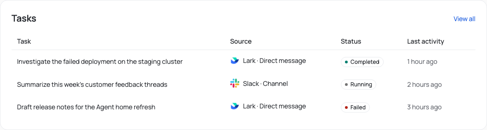
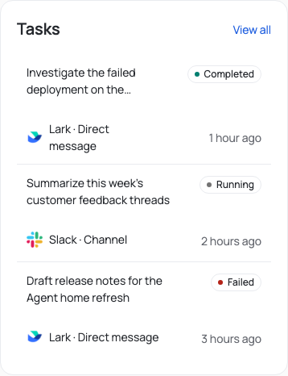
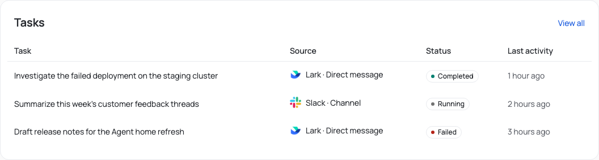
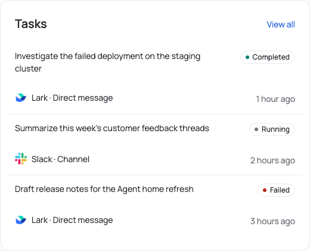
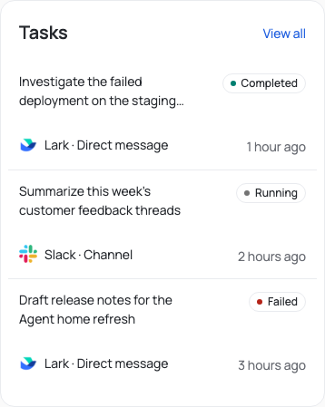
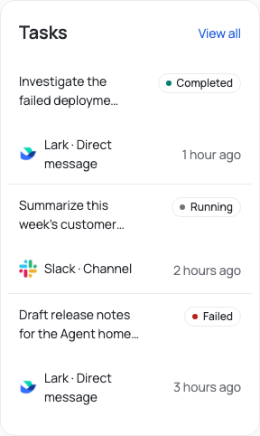

# Agent home Tasks alignment

Supports the [Web design contract](../../../docs/system/web/design.md) for tables inside section cards.

Verified on 2026-11-03 against a production Web build of the Agent home Tasks section, rendered inside the Agent shell
content frame with the real application CSS and representative Task fixtures. Screenshots use demonstration Tasks.

Kumo pads every Table header and body cell by 12 px, so the Tasks section placed table text 12 px to the right of its
`Tasks` heading. Inside the section card, the table region now offsets that padding, so header and row text start on
the heading's edge. In the stacked narrow layout, the trailing status and time column also ends on the `View all` edge.
The Account-wide Tasks page keeps its own card and is unchanged.

Before:

After:

[`measurements.json`](./measurements.json) records the offset from the heading text to the first table text at 320, 390,
768, and 1440 px: 12 px before and 0 px after at every width, with no page-level horizontal overflow. Widths up to
768 px use the stacked row layout; 1440 px uses the table layout.
