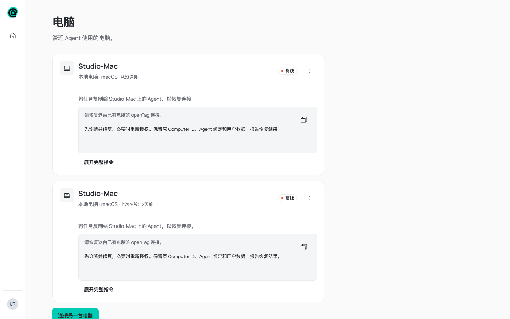
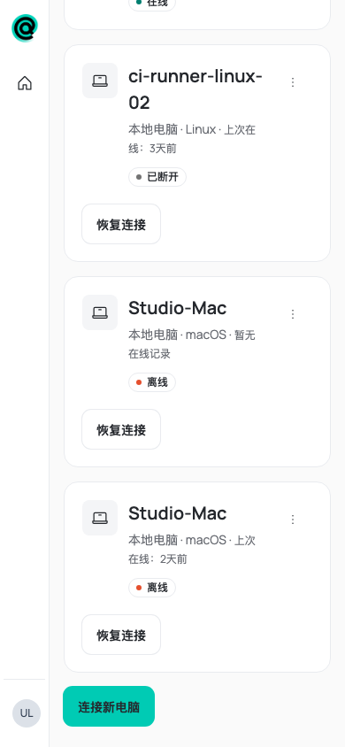
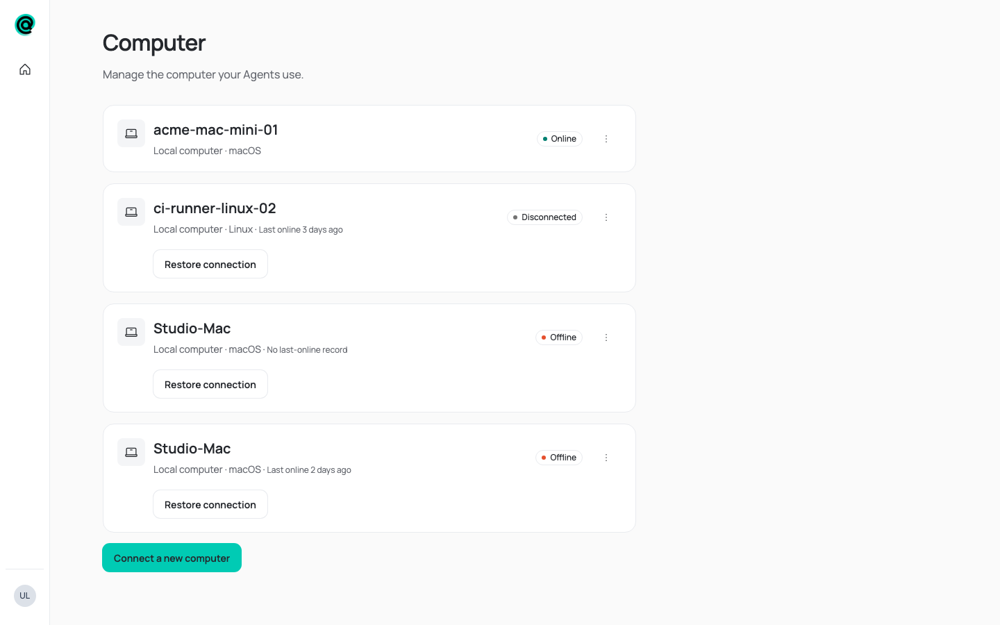
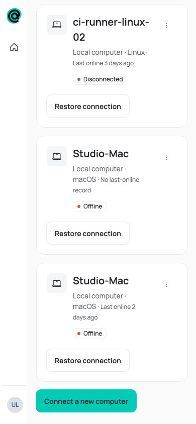

# Computer last-online line

Verified against this branch's Web build in the local UX Lab with two demonstration Computers named `Studio-Mac`.
One was last online two days ago; the other has no last-online timestamp.
Contract: [Computer connection controls](../../../docs/system/web/computer-connection-controls.md) and
[recognizing a machine after its local identity is lost](../../../docs/system/server-client-boundary.md#recognizing-a-machine-after-its-local-identity-is-lost).

Every offline Local card now carries a second line, so two cards with the same name can be told apart:
“上次在线：2天前 / Last online 2 days ago” or, without a timestamp, “暂无在线记录 / No last-online record”.
At 390 px the line wraps under the platform text and the Offline badge moves below it, with no page-level horizontal
overflow. At 1440 px it stays on the identity row.

Chinese, 1440 px:

Chinese, 390 px:

English, 1440 px:

English, 390 px:

