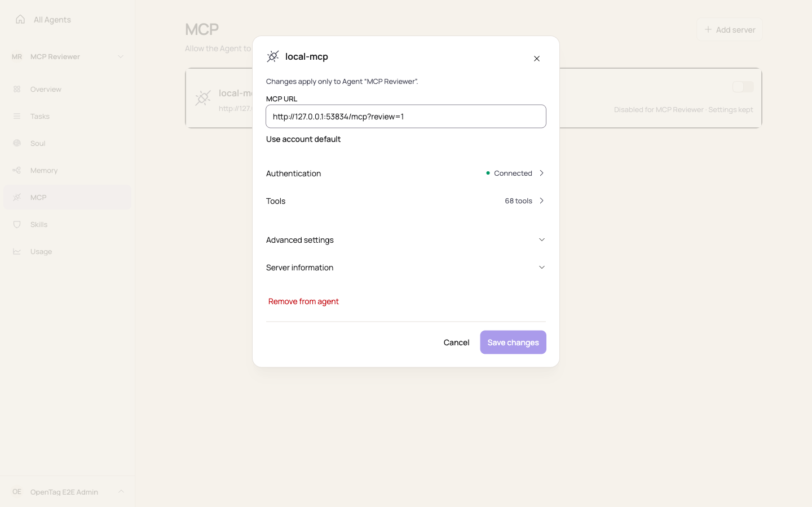
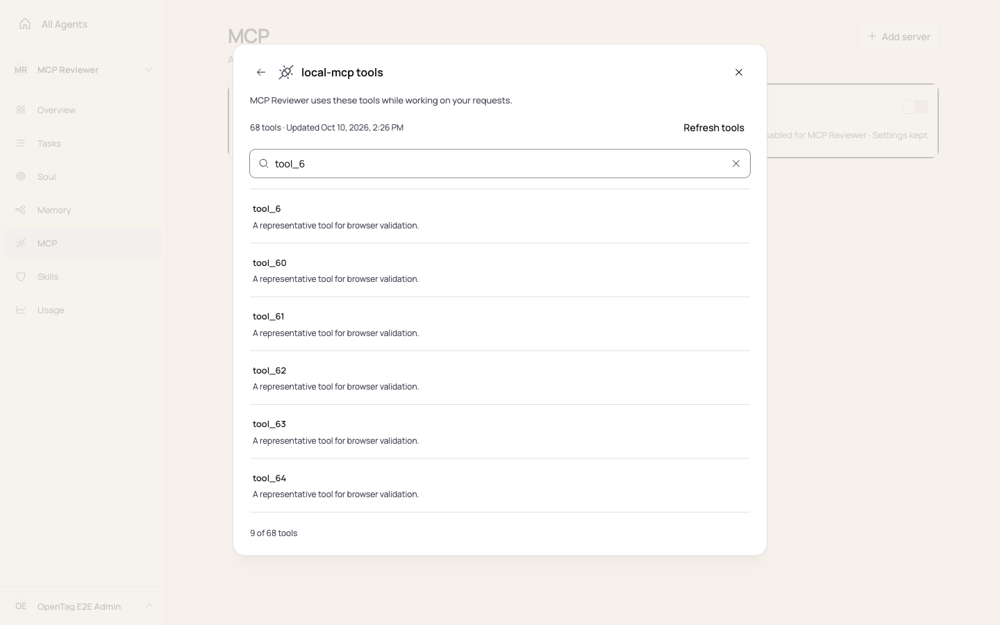
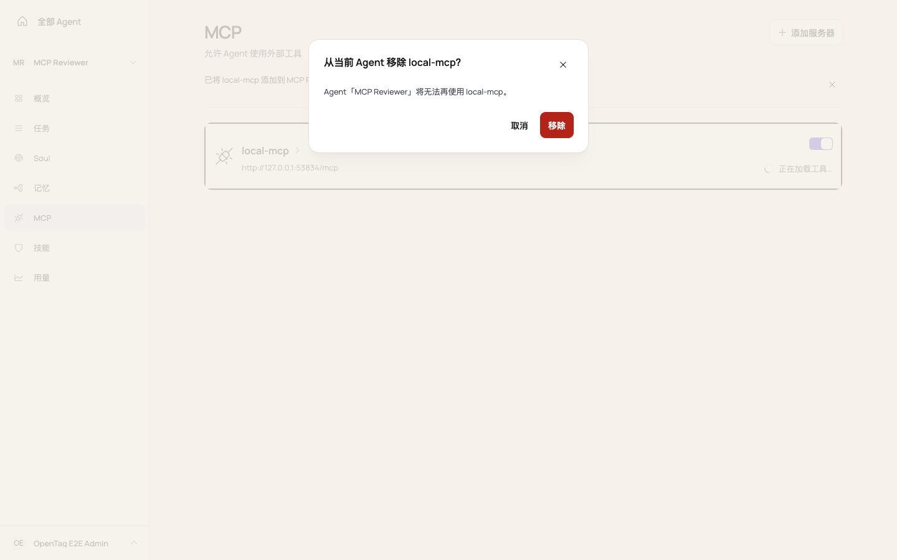

# Connector management UI validation

The current UI uses Connectors, Add custom, and Discover. Earlier screenshots record the UI before this rename; the MCP protocol and page URL remain unchanged.

## Empty state refinement (2026-10-12)

The page describes its purpose as connecting the Agent to external tools. The empty state uses the existing
connection icon at 32px, an 18px heading and concise guidance directly on the page background, matching Skills.
Discover and Add custom remain in the page header; connector choices appear only in Discover, with no
Quick start cards or duplicate browse action on the management page. Add custom opens the same
URL-and-shortcuts dialog for an Agent with no mounted Servers and an Agent with existing mounts.

- [Desktop empty state (1440 × 900)](./empty-desktop.png)
- [English empty state (320 × 640)](./empty-320.png)
- [Chinese empty state (320 × 640)](./empty-zh-320.png)

These historical screenshots predate the separate Discover action and Connectors rename. They use the production
React components and theme in a disposable built preview with synthetic in-memory API responses.
They do not claim live storage or provider validation. Browser checks confirmed the Add server
action opens its dialog and the 320px document has no horizontal overflow. The
[Add-flow validation](../mcp-add-server/README.md) covers the current URL entry and server shortcuts.
This empty-state follow-up checked 320px and 1440px; intermediate widths and axe scans were not repeated.
No reusable block, theme value or CSS exception was added.

## Restored empty state validation (2026-10-12)

After the standalone directory replaced the original empty state with Quick start cards, the page
again uses the compact icon, heading, and guidance shared with Skills. The two header actions remain.
Connector and i18n unit tests passed: 346 tests across 24 files. Repository checks, workspace build,
and workspace typecheck passed.

A disposable production-component preview with synthetic empty API responses was checked in Chromium
at 320, 390, 768, and 1440px in English and Chinese, with no horizontal document overflow. Discover
opened its searchable directory; page unit tests also verified that Add custom opens its URL dialog.
This preview does not validate live server connections or third-party authorization. Earlier
screenshots above remain historical.

- [Restored desktop empty state (1440 × 900)](./restored-empty-desktop.png)
- [Restored English empty state (320 × 640)](./restored-empty-320.png)
- [Restored Chinese empty state (320 × 640)](./restored-empty-zh-320.png)

## Existing management journeys

The connector list opens server details from the service identity and keeps the Agent enable switch independent.
Details group Authentication, Tools, Advanced settings and Connector information in that order. Authentication and
Tools replace the current dialog and return to their source; destructive confirmations replace it as well.

## Browser validation

The implementation was exercised in a real Chromium browser against built Web assets, OpenTag APIs, an isolated
PostgreSQL database and a local MCP/OAuth provider fixture. The fixture exposed 68 tools. No production provider
credentials or accounts were used. Screenshots below use disposable fixture data.

| Journey | Verified behavior |
| --- | --- |
| Unsaved settings to Tools to Reconnect | Keep editing preserves the draft. Save and continue persists settings before opening authentication. |
| OAuth | Real discovery, consent redirect, token exchange and callback restore the originating Tools view. A denied consent callback shows an inline error; cancellation and retry preserve the search query. Consumed errors do not reappear on subsequent entry. |
| API key and no authentication | Method selection, masked/revealed input, credential save, failure retry and return navigation work. |
| Clear credentials | Cancellation keeps the typed draft. Confirmation clears the credential and tool snapshot, returns to authentication and empties the key field. |
| Tools | Search empty state, query preservation through Details, refresh progress, cached results on failure and successful retry work. Refreshing a disabled server does not enable it. |
| Remove from agent | Cancellation retains settings, disclosures and focus. Pending confirmation ignores Escape. Failure stays inline and can be retried. Successful removal closes the dialogs, removes the row and focuses Add custom for the empty list. |
| Account scope | Removing the Agent binding leaves the account server available. It can be reattached through the existing-server picker without a duplicate row. |

Refresh, credential-save and removal failures were injected as HTTP 503 responses at the browser network boundary;
successful retries used the real API. OAuth denial was injected at the consent redirect and processed by the real
callback endpoint. Public provider compatibility was not tested.

## Responsive and accessibility evidence

| Language and dialog | 320px | 390px | 768px | 1440px |
| --- | --- | --- | --- | --- |
| English expanded Details | Pass | Pass | Pass | Pass |
| English Tools | Pass | Pass | Pass | Pass |
| English API key authentication | Pass | Pass | Pass | Pass |
| English remove confirmation | Pass | Pass | Pass | Pass |
| Chinese collapsed and expanded Details | Pass | Pass | Pass | Pass |
| Chinese Tools and authentication | Pass | Pass | Pass | Pass |
| Chinese remove confirmation and list | Pass | Pass | Pass | Pass |

Pass means no horizontal document/dialog overflow and no dialog extending beyond the viewport. Automated axe
WCAG 2 A/AA and WCAG 2.1 AA scans of the tested dialogs reported zero violations. Twenty-five sequential Tab stops
remained within Details or its standard focus guards. Browser checks also verified focus restoration after cancel
and removal. These checks do not replace a manual accessibility audit.

The UI reuses the existing Dialog, Button, Field, Input and Collapsible primitives. MCP-specific CSS controls list
alignment, dialog scroll bounds, grouped rows and mobile layout; it introduces no theme values or global overrides.

## Screenshots

Desktop captures accompany the responsive assertions above; no mobile screenshot is claimed.

