# Agent setup copy trim

Supports the [Web design contract](../../../docs/system/web/design.md).

Reviewed on 2026-11-03 against the built application's Agent Setup Lab (`/internal/agent-setup`), which runs on its
in-memory adapter and reaches no Server. "Review Mac" and "Reviewer" are demonstration fixtures; the screenshots contain
no connection codes or credentials.

## Removed copy

Each line restated what the page title, step rail, choices, or footer already said.

| Page | English | Chinese |
| --- | --- | --- |
| Connect your computer (every Computer state) | {name} runs on your computer; messages and results pass through openTag. | {name} 在你的电脑上运行，消息和结果经由 openTag 传递。 |
| Prepare this computer | Connect a messaging app once these checks pass. | 以下检查通过后，即可连接消息应用。 |
| Connect your messaging app | Pick the app your team already works in. | 选择团队已经使用的应用。 |

The Connect computer page keeps only its title above the Computer status. Setup actions, status lines, recovery
guidance, and the ready screen's readiness-versus-delivery note are unchanged.

## Screenshots

Connect your computer, before and after:

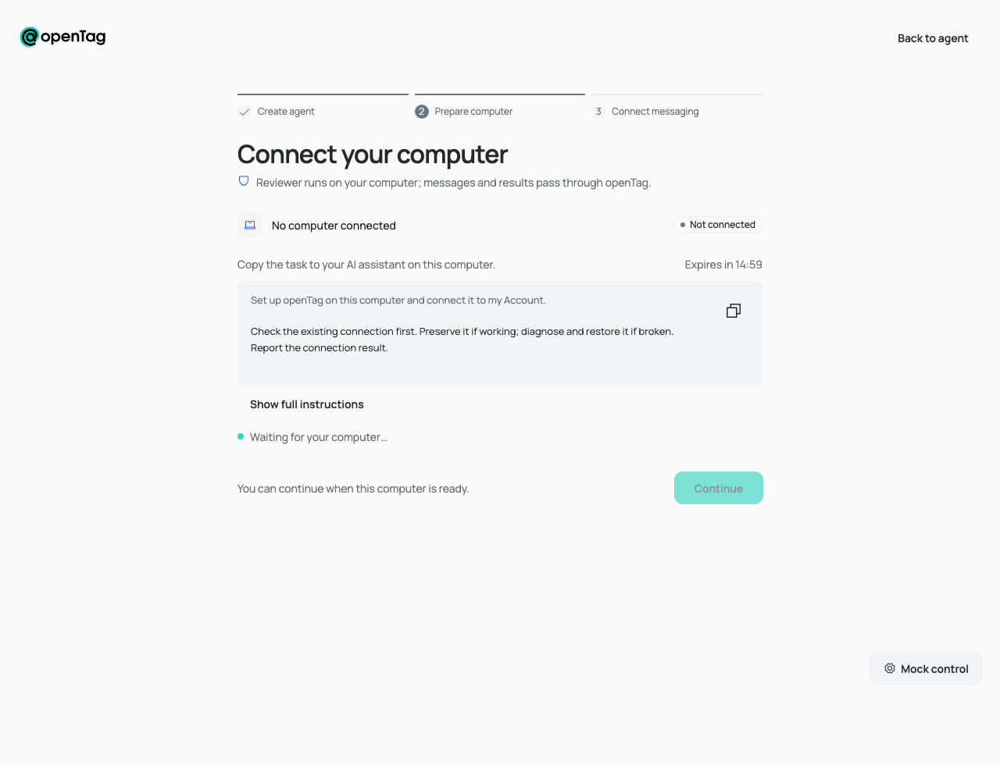
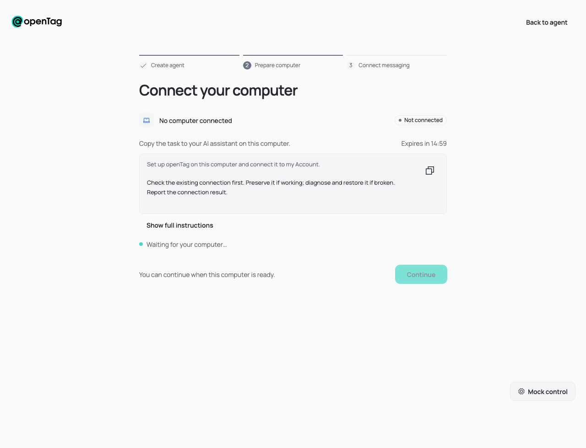
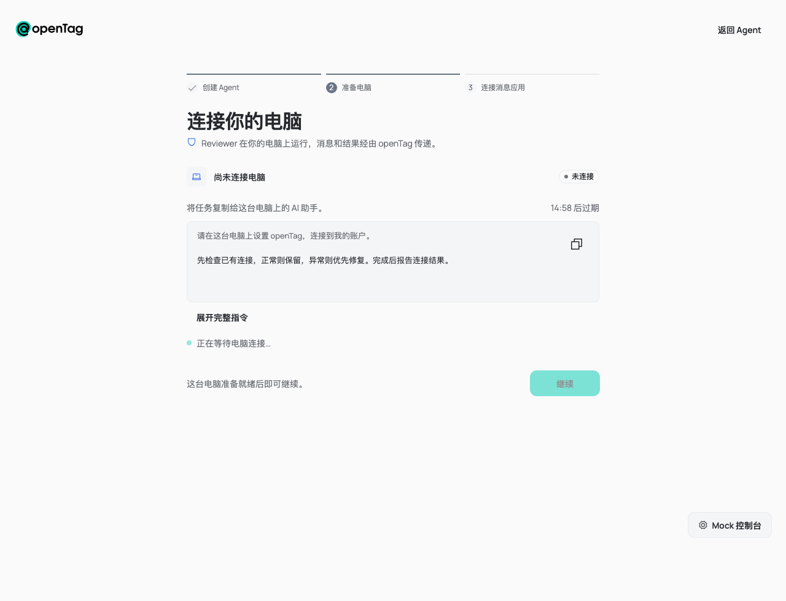
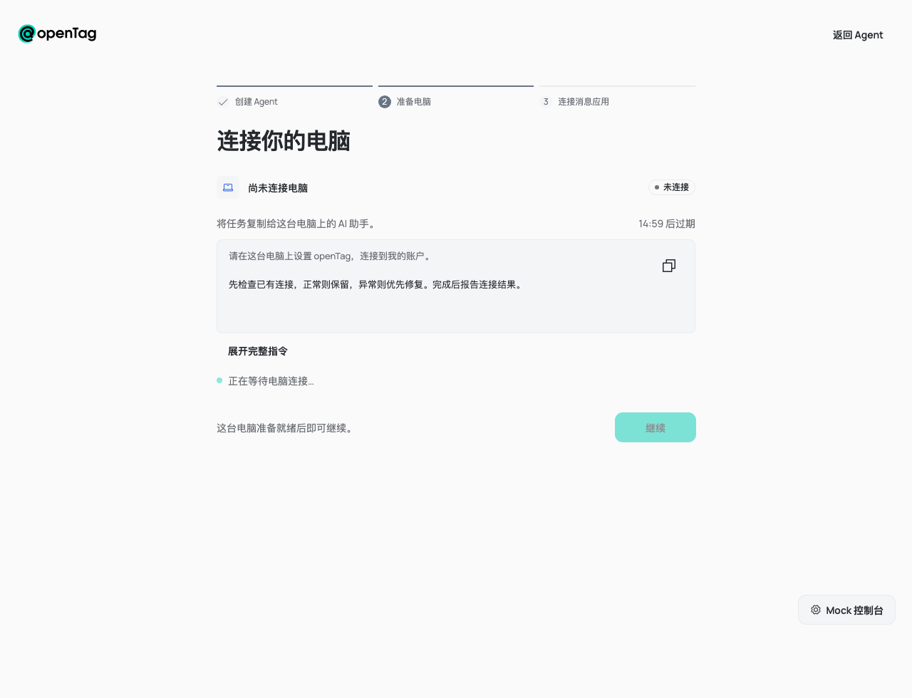

Prepare this computer, before and after:

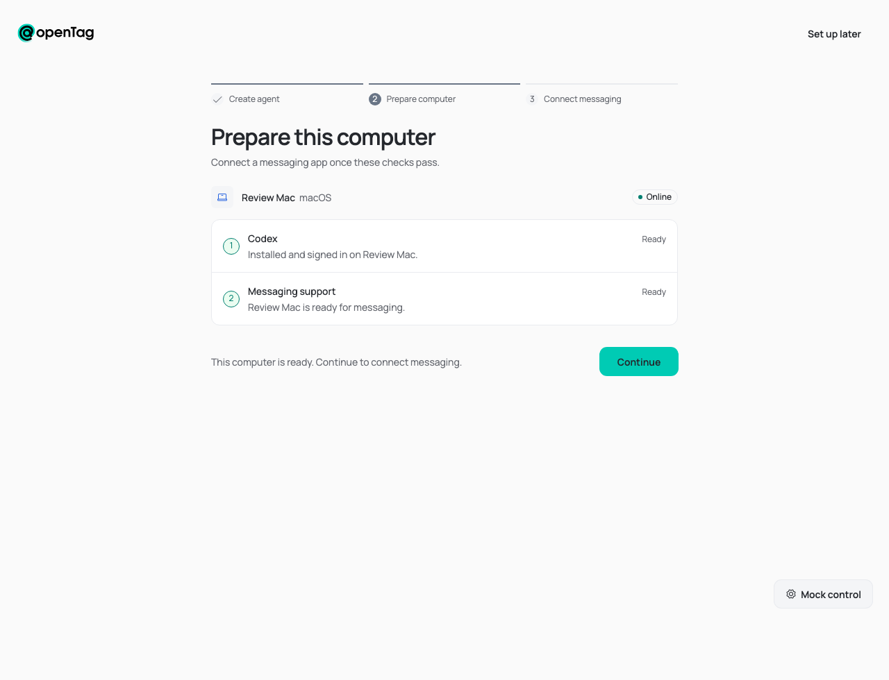
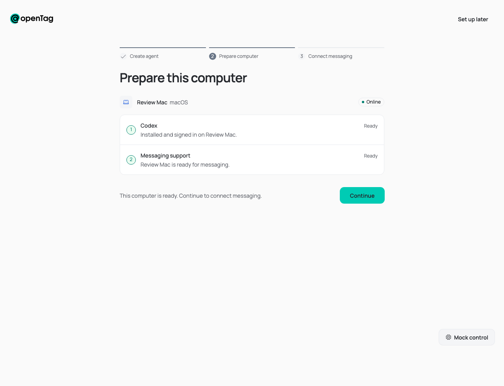
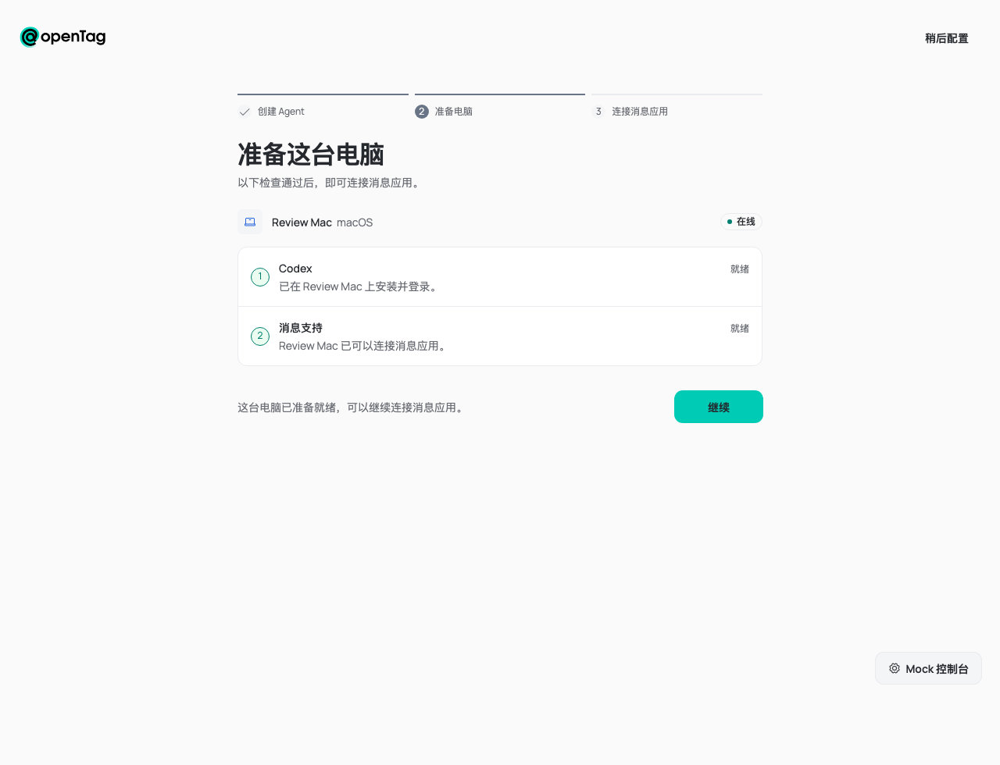
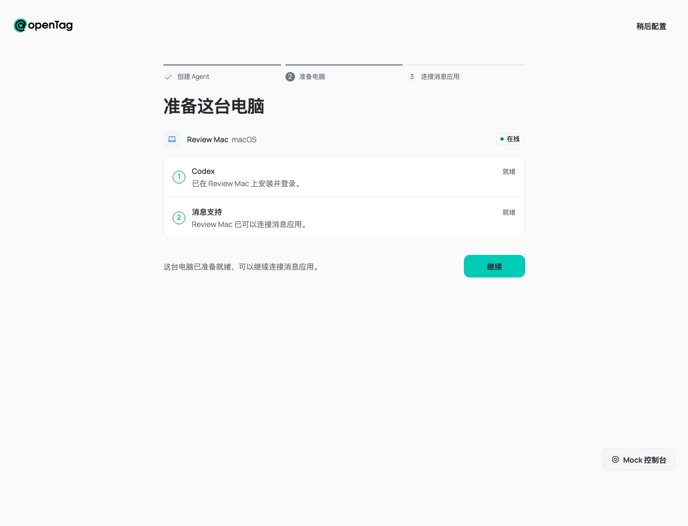

Connect your messaging app, before and after:

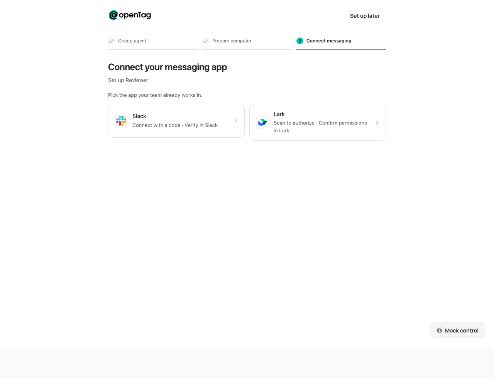
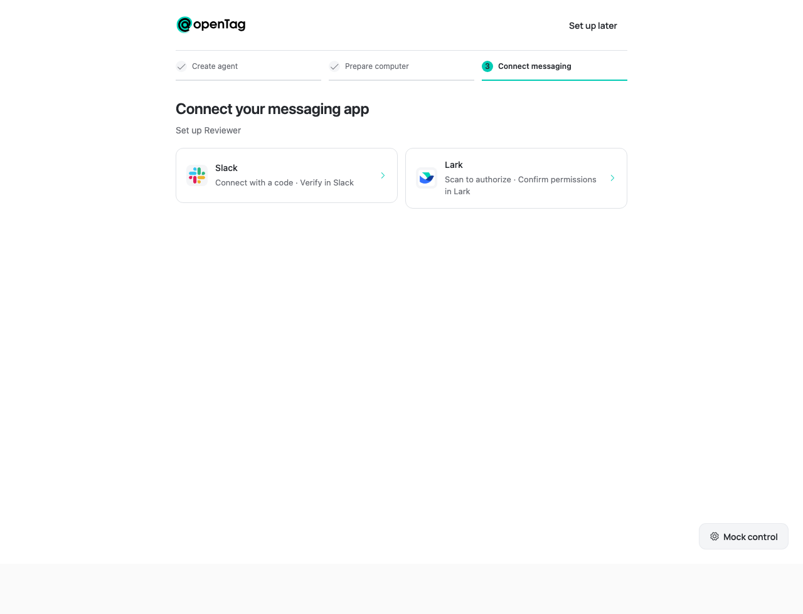
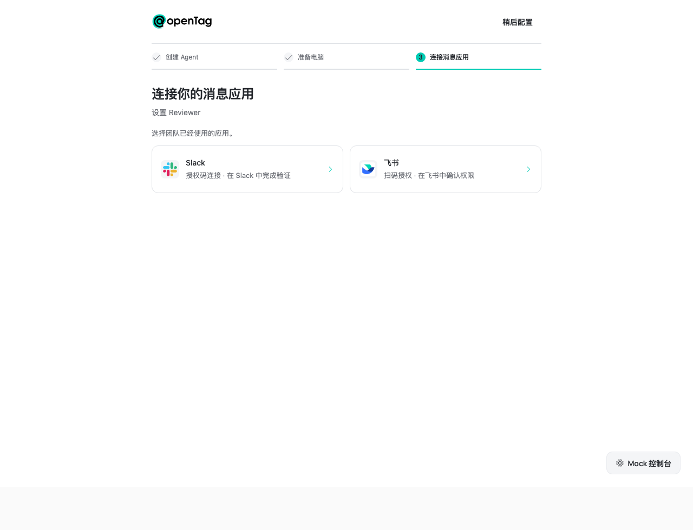
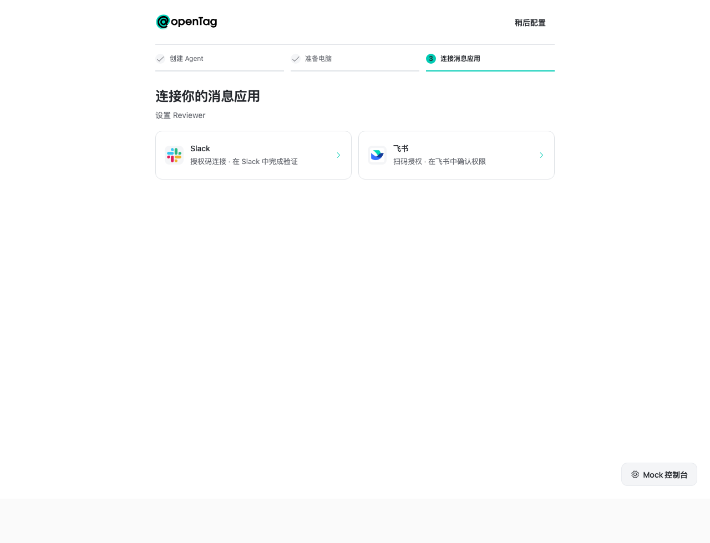

## Repeatable browser check

Build the Web app and its dependencies, serve the build, and open the Lab:

```bash
pnpm exec turbo run build --filter=@opentag/web
pnpm --filter @opentag/web exec vite preview --port 5317 --host 127.0.0.1
```

In **Mock control**, choose each **Screen** (Connect computer, Verify environment, Connect messaging) and the screen
states shown above. Set `localStorage.PARAGLIDE_LOCALE` to `zh` for the Chinese pass.
